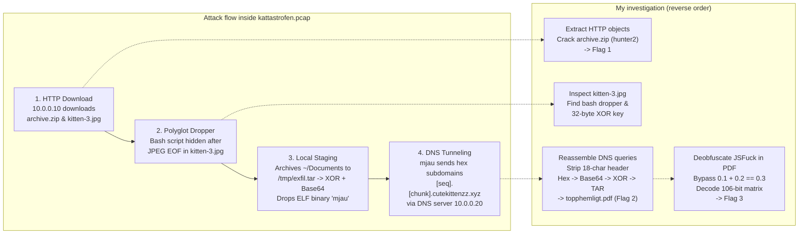

# Network Forensics & DNS Tunneling Investigation ("Operation Kattastrofen")

An incident analysis and network forensics lab where I investigated a packet capture
(`kattastrofen.pcap`) from a compromised Linux workstation, reconstructed a covert DNS tunneling
exfiltration channel, decoded a multi-stage payload hidden inside a JPEG image, and wrote detection
rules and security policy recommendations to stop the same attack from happening again.

This assignment was Lab 2 in the course **Security Policy & Incident Analysis** (*Säkerhetspolicy &
incidentanalys*). The technical scenario is based on **"Operation Kattastrofen"**, a forensic CTF
work sample originally created by the Swedish National Defence Radio Establishment (**FRA**,
*Försvarets radioanstalt*). An employee at a government agency had been browsing and downloading
cat pictures during work hours, accidentally running a dropper hidden inside one of the images that
stole a classified PDF over DNS.

**Course:** Security Policy & Incident Analysis · **Tools:** Wireshark, `tshark`, CyberChef, Linux
CLI (`binwalk`, `strings`, `file`, `xxd`), Node.js / JavaScript, Suricata, Sigma · **Report:**
[`Incident_Report_DNS_Tunneling_Exfiltration.pdf`](Incident_Report_DNS_Tunneling_Exfiltration.pdf)

---

## Contents

- [What I did](#what-i-did)
- [Incident overview and kill chain](#incident-overview-and-kill-chain)
- [Step by step](#step-by-step)
- [Problems I ran into and how I solved them](#problems-i-ran-into-and-how-i-solved-them)
- [Detection rules and policy improvements](#detection-rules-and-policy-improvements)
- [The most important things I learned](#the-most-important-things-i-learned)
- [Files in this folder](#files-in-this-folder)

---

## What I did

- Analyzed **`kattastrofen.pcap`** in Wireshark using protocol hierarchy and conversation statistics
  to find the compromised machine (`10.0.0.10`) and the internal DNS server (`10.0.0.20`)
- Extracted downloaded files (`archive.zip` and `kitten-*.jpg`) from the unencrypted HTTP stream and
  recovered **Flag 1**
- Found a **polyglot JPEG/bash dropper** hidden at the end of `kitten-3.jpg` that archived the user's
  `Documents` folder, XOR-encrypted it, and dropped an ELF binary named `mjau`
- Reconstructed the **DNS tunneling stream** to `cutekittenzz.xyz`, stripped the 18-character
  sequence headers, reversed the hex, Base64, and 32-byte repeating XOR encryption in CyberChef, and
  recovered the stolen `topphemligt.pdf` document (**Flag 2**)
- Deobfuscated an **esoteric JSFuck script** inside the PDF, fixed an IEEE 754 floating-point trap
  (`0.1 + 0.2 == 0.3`), and decoded a 106-bit binary matrix into an ASCII banner (**Flag 3**)
- Wrote **Suricata** and **Sigma** detection rules for DNS exfiltration and translated the technical
  weaknesses into concrete security policy updates

---

## Incident overview and kill chain



### Network traffic breakdown

| IP Address | Role in the network | Share of captured packets | What stood out |
|---|---|---|---|
| `10.0.0.10` | Compromised client workstation | **99.93%** | Involved in almost every packet in the capture; downloaded the files over HTTP and sent thousands of DNS queries |
| `10.0.0.20` | Internal DNS resolver | **93.96%** | Forwarded recursive DNS queries for `*.cutekittenzz.xyz` out to the attacker's authoritative name server |
| `cutekittenzz.xyz` | Attacker C2 domain | All DNS exfiltration traffic | Each query carried a sequence number and a hex-encoded slice of `/tmp/exfil.dat` in the subdomain label |

### Captured flags and artifacts

| Artifact | How it was hidden | Recovered result |
|---|---|---|
| `archive.zip` | Exported from HTTP stream, password-protected with `hunter2` | **Flag 1:** `flagga1{klassiska_lösenord_för_100}` |
| `kitten-3.jpg` | Valid JPEG image with a bash dropper appended after the image data | Revealed `/tmp/exfil.dat`, the 32-byte XOR key, and the `mjau` ELF binary |
| `topphemligt.pdf` | Inside `/tmp/exfil.tar`, exfiltrated over DNS (`cutekittenzz.xyz`) | **Flag 2:** `flagga2{every_day_is_caturday}` |
| Embedded JS payload | Obfuscated with JSFuck (`[]()!+`), guarded by `0.1 + 0.2 == 0.3` | **Flag 3:** `flagga3{mj4u!}` |

---

## Step by step

### 1. Triaging the PCAP and finding the HTTP downloads (Flag 1)

I started by opening `kattastrofen.pcap` in Wireshark and checking *Statistics > Protocol Hierarchy*
and *Statistics > Conversations* instead of scrolling through raw packets. Two hosts immediately
stood out: `10.0.0.10` was present in 99.93% of all packets, and `10.0.0.20` (running DNS on UDP
port 53) was in 93.96% of them.

Before diving into the massive DNS stream, I filtered for `http` to see how the infection started.
The user on `10.0.0.10` had visited a website and downloaded `archive.zip` along with several cat
pictures (`kitten-1.jpg`, `kitten-2.jpg`, `kitten-3.jpg`). I used *File > Export Objects > HTTP* in
Wireshark to save all of them to disk. `archive.zip` was password-protected, and testing classic
weak passwords unlocked it with `hunter2`, giving me **Flag 1**:
`flagga1{klassiska_lösenord_för_100}`.

**What I learned**
- Starting with *Protocol Hierarchy* and *Conversations* gives you an immediate map of who talked to
  whom and what protocol dominates the capture. Seeing 94% DNS traffic on a single workstation is a
  huge red flag right away.
- Unencrypted HTTP makes it trivial for anyone with a packet capture to reconstruct the exact files a
  user downloaded byte for byte.

### 2. Analyzing the polyglot dropper in `kitten-3.jpg`

Next, I inspected the exported cat pictures on Linux using `file`, `strings`, and `binwalk`.
`kitten-1.jpg` and `kitten-2.jpg` were normal images, but `kitten-3.jpg` had extra data appended
at the end of the JPEG structure. Opening it in a hex/text view showed a shell script disguised inside
the image file:

1. When executed, the script copies itself to `/tmp` and opens the actual JPEG image in an image
   viewer so the user thinks they just opened a normal picture.
2. In the background, it packages the user's `$HOME/Documents` directory into a tar archive
   (`/tmp/exfil.tar`).
3. It encrypts the tar file using a **32-byte repeating XOR key** and encodes the result with Base64
   into `/tmp/exfil.dat`.
4. Finally, it unpacks an embedded ELF binary into `/tmp/mjau`, marks it executable (`chmod +x`), and
   runs it.

**What I learned**
- A **polyglot file** is valid in more than one format at the same time. Image viewers stop reading
  when they hit the JPEG End-Of-Image (`FF D9`) marker, while the shell script can read from a
  specific byte offset (`tail` / `dd`) to extract its payload.
- Finding the dropper script *before* trying to decode the network traffic saved hours of guessing,
  because the script gave me the exact recipe (`tar` → 32-byte XOR → Base64) and the XOR key used to
  encrypt the stolen data.

### 3. Reconstructing the DNS tunneling stream

Looking at the `mjau` binary and the DNS traffic in Wireshark showed how the data left the network.
Instead of opening a direct TCP connection to an external IP (which a firewall would block), `mjau`
read `/tmp/exfil.dat`, converted it to hexadecimal, chopped it into chunks, and sent DNS queries
for subdomains under `cutekittenzz.xyz` through the internal DNS server `10.0.0.20`:

```text
<18-char-sequence-header>.<hex-encoded-payload-chunk>.cutekittenzz.xyz
```

Because `10.0.0.20` allows recursive lookups for any external domain, it forwarded every single
query out to the attacker's authoritative name server for `cutekittenzz.xyz`, which logged the
subdomain queries and reassembled the file.

I extracted all unique queries to `cutekittenzz.xyz` in order using `tshark`:

```bash
tshark -r kattastrofen.pcap -Y "dns.flags.response == 0 && dns.qry.name contains cutekittenzz.xyz" \
  -T fields -e dns.qry.name > dns_queries.txt
```

**What I learned**
- **DNS tunneling** abuses the fact that almost every network allows UDP port 53 to an internal DNS
  resolver, and that resolver will happily forward queries to the internet on the client's behalf.
- UDP does not guarantee packet order and DNS resolvers retry queries, so the malware prepended an
  18-character sequence header to each subdomain so the attacker could sort and deduplicate the
  chunks.

### 4. Decrypting the payload in CyberChef (Flag 2)

Once I had the ordered list of DNS queries, I stripped the `.cutekittenzz.xyz` suffix and the
18-character sequence header from each line and concatenated all the hex chunks into one continuous
string.

Then I loaded the hex string into **CyberChef** and built a recipe that reversed the dropper's steps
in exact opposite order:
1. **From Hex** (converting the DNS-safe hex labels back to the Base64 string from `/tmp/exfil.dat`)
2. **From Base64** (recovering the raw XOR-encrypted bytes)
3. **XOR** with the **32-byte key** I had found inside `kitten-3.jpg`
4. **Untar** to extract the files from `/tmp/exfil.tar`

Out came the user's stolen `Documents` folder containing a classified PDF file named
`topphemligt.pdf`. Opening the PDF gave me **Flag 2**: `flagga2{every_day_is_caturday}`.

**What I learned**
- Encoding and encryption are two different layers: **hex** and **Base64** are only there so binary
  data survives DNS character limits without corruption, while the **32-byte XOR key** hides the
  file header (`%PDF` / `ustar`) from simple network signatures.
- CyberChef makes it easy to test each layer step by step and immediately see when the `ustar` tar
  archive header appears in the output pane.

### 5. Deobfuscating the JSFuck script and IEEE 754 trap (Flag 3)

Inside `topphemligt.pdf` there was one more puzzle: a block of obfuscated JavaScript written in
**JSFuck**—an esoteric style that writes valid JavaScript using only six characters: `[`, `]`, `(`,
`)`, `!`, and `+`.

After decoding the JSFuck layer into readable JavaScript, I found a logic check guarding the final
output:

```javascript
if (0.1 + 0.2 == 0.3) {
    // decode and print flag 3
}
```

In standard JavaScript (which uses 64-bit IEEE 754 floating-point numbers), `0.1 + 0.2` evaluates to
`0.30000000000000004`, so `0.1 + 0.2 == 0.3` is always **`false`**! If you just run the script as-is,
it silently does nothing.

I patched the condition in the deobfuscated script so the branch executed. The script unpacked a
106-bit binary matrix and rendered it as an `#` and space ASCII-art banner in the terminal, spelling
out **Flag 3**: `flagga3{mj4u!}`.

**What I learned**
- Malware and CTF challenges often include **anti-analysis traps** that look like normal code at a
  glance. Reading the deobfuscated code before running it made the `0.1 + 0.2 == 0.3` floating-point
  trick obvious.
- Binary numbers `0.1` and `0.2` are repeating fractions in base 2 (just like `1/3` in base 10),
  which is why rounding errors happen when adding them in IEEE 754 floating point.

---

## Problems I ran into and how I solved them

| Problem | Cause | Solution |
|---|---|---|
| Thousands of DNS packets made Wireshark noisy | Every chunk of the PDF generated both a query and a response, plus retries | Filtered for queries only (`dns.flags.response == 0`) and deduplicated by the 18-character sequence header |
| Extracting the hex chunks directly produced corrupted Base64 | Each subdomain started with an 18-character sequence/metadata prefix before the actual data chunk | Stripped the first 18 characters and the `.cutekittenzz.xyz` suffix from each query before joining the hex strings |
| The JavaScript payload inside the PDF ran without errors but printed nothing | The `if (0.1 + 0.2 == 0.3)` check always evaluates to `false` in IEEE 754 floating point | Bypassed the condition in Node.js so the 106-bit binary matrix decoder ran and printed the ASCII banner |

---

## Detection rules and policy improvements

The second half of the course assignment was translating what went wrong technically into detection
rules for a SOC and concrete changes to the agency's security policy.

### Suricata IDS rule for high-entropy DNS tunneling

```suricata
alert dns $HOME_NET any -> any 53 (
    msg:"SOC ALERT - Potential DNS Tunneling Exfiltration Long Subdomain Query";
    dns.query;
    content:".xyz"; endswith;
    pcre:"/^[a-f0-9]{18}\.[a-f0-9]{30,}\./i";
    threshold: type both, track by_src, count 20, seconds 60;
    classtype:policy-violation;
    sid:1000042; rev:1;
)
```

### Sigma rule for DNS exfiltration bursts

```yaml
title: Suspicious DNS Tunneling Subdomain Length and Query Burst
status: experimental
description: Detects unusually long hexadecimal subdomain labels typical of DNS tunneling tools (such as the mjau exfiltration binary).
logsource:
    category: dns
detection:
    selection:
        query|re: '^[0-9a-fA-F]{16,24}\.[0-9a-fA-F]{32,}\.'
    condition: selection
level: high
tags:
    - attack.exfiltration
    - attack.t1048.003
```

### Policy changes I recommended in the report

- **DNS egress filtering and Response Policy Zones (RPZ):** Clients should never be able to resolve
  arbitrary newly registered domains or cheap TLDs like `.xyz` that have no business use. Configure
  DNS firewall rules / RPZ on `10.0.0.20` and alert on high query volume or long subdomain labels.
- **Application control (`noexec` on `/tmp`):** The dropper worked because a regular user could
  write an ELF binary (`mjau`) into `/tmp` and execute it. Mounting `/tmp` and `/dev/shm` with the
  `noexec`, `nosuid`, and `nodev` options stops payloads from running out of temporary folders.
- **Separating classified documents from internet-connected browsing:** A workstation that holds
  classified documents (`topphemligt.pdf`) should not have unrestricted HTTP access to browse and
  download files from the open internet.

---

## The most important things I learned

- **DNS is a blind spot if you only watch the firewall.** Blocking direct outbound ports does not
  stop data exfiltration if the internal DNS resolver forwards everything to the internet without
  inspection.
- **Find the dropper before fighting the traffic.** Reading the bash script inside `kitten-3.jpg`
  gave me the exact 32-byte XOR key and encoding order (`tar` → XOR → Base64 → hex), turning a
  cryptanalysis problem into a straightforward CyberChef recipe.
- **Technical findings should lead to policy and architectural fixes.** Catching one domain
  (`cutekittenzz.xyz`) in an IDS rule is only a temporary patch; mounting `/tmp` with `noexec` and
  filtering recursive DNS stops the whole class of attack.

---

## Files in this folder

```
01-network-forensics-dns-tunneling/
├── README.md                                          <- This overview
└── Incident_Report_DNS_Tunneling_Exfiltration.pdf     <- Full Swedish incident analysis & policy report
```
