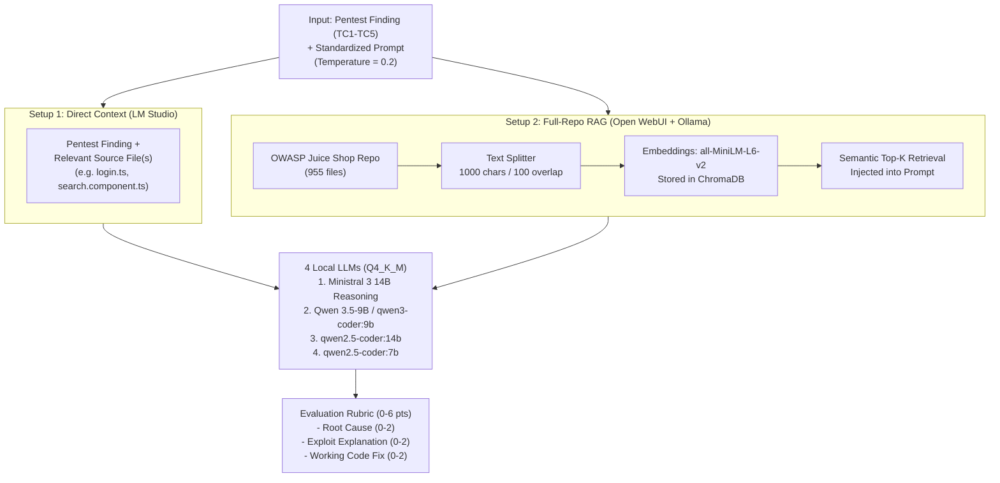

# Can Local LLMs Find and Fix Security Bugs from Pentest Reports? (BSc Thesis)

My Bachelor of Science thesis in Information Systems at the **University of Borås** (Spring 2026),
written together with **Aiman Ibrahim Belhadj** and **Brian Muhirwa**. We tested whether small,
locally hosted Large Language Models (7B to 14B parameters) running completely offline on consumer
hardware can take a real penetration test report and the source code of **OWASP Juice Shop**, find
the root cause in the code, explain how the vulnerability is exploited, and write a working code
fix.

Many companies want to use AI to speed up vulnerability remediation after a penetration test, but
they cannot paste proprietary source code or confidential pentest reports into cloud APIs like
ChatGPT or Claude for privacy and compliance reasons. We wanted to see how well local open-weight
models perform on standard desktop hardware, and whether giving the model the whole codebase via
**Retrieval-Augmented Generation (RAG)** works as well as giving it the relevant source files
directly.

**Degree Project:** B.Sc. Thesis in Informatics (15 ECTS, Course `C3INF1`, Spring 2026) ·
**Authors:** Aiman Ibrahim Belhadj, Brian Muhirwa, Mohamed Said · **Tools:** Ollama, LM Studio,
Open WebUI, ChromaDB (`all-MiniLM-L6-v2`), OWASP Juice Shop · **Full thesis (111 pages, Swedish):**
[`BSc_Thesis_LLM_Vulnerability_RCA.pdf`](BSc_Thesis_LLM_Vulnerability_RCA.pdf)

---

## Contents

- [What we tested](#what-we-tested)
- [Experimental setup](#experimental-setup)
- [Step by step](#step-by-step)
- [Results across all 40 test runs](#results-across-all-40-test-runs)
- [What went wrong for the models and why](#what-went-wrong-for-the-models-and-why)
- [The most important things I learned](#the-most-important-things-i-learned)
- [Files in this folder](#files-in-this-folder)

---

## What we tested

- **Two different ways of feeding code to a local LLM:**
  1. **Direct Context (LM Studio):** We gave the model the pentest report finding alongside the
     specific source code file(s) where the vulnerability lived.
  2. **Full-Repository RAG (Open WebUI + ChromaDB):** We indexed all **955 files** of OWASP Juice
     Shop into a vector database (`all-MiniLM-L6-v2`, 1000-character chunks with 100-character
     overlap) and let the RAG pipeline retrieve the code automatically from the pentest report prompt.
- **Four local open-weight models (7B–14B):** `Ministral 3 14B Reasoning`, `Qwen 3.5-9B`
  (`qwen3-coder:9b`), `qwen2.5-coder:14b`, and `qwen2.5-coder:7b`, all running in `Q4_K_M` 4-bit
  quantization with `temperature = 0.2`.
- **Five test cases (TC1–TC5)** drawn from two real penetration test reports on OWASP Juice Shop
  (one professional report by **Schutzwerk GmbH** and one student report by **Hack & Fix**),
  including one test case (**TC3**) where the pentest report **misclassified** a DOM-XSS bug as
  Reflected XSS.
- **40 controlled test runs** (`5 test cases × 4 models × 2 setups`), graded against a strict
  **0–6 point rubric**:
  - **Root Cause Identification (0–2 pts):** Did it find the exact file, function, and vulnerable
    code line?
  - **Exploitability Explanation (0–2 pts):** Did it accurately trace how attacker input reaches
    that sink?
  - **Remediation Code (0–2 pts):** Did it write valid TypeScript/Express/Angular code that fixes
    the vulnerability without breaking the app?

---

## Experimental setup



### Hardware and software environment

| Component | Configuration | Why we chose it |
|---|---|---|
| CPU & System RAM | AMD Ryzen 5 7600 (6 cores / 12 threads) · 32 GB DDR5 RAM | Represents realistic desktop hardware available to a developer or small security team |
| Quantization & Temperature | `Q4_K_M` (4-bit quantization) · `temperature = 0.2` | Fits 7B–14B models in memory and keeps outputs consistent and deterministic |
| Target codebase | **OWASP Juice Shop** (955 files, Node.js, Express, TypeScript, Sequelize, Angular 14) | A realistic modern web application with known vulnerabilities and public pentest reports |
| Vector database (RAG) | ChromaDB in Open WebUI · `sentence-transformers/all-MiniLM-L6-v2` · `1000` char chunks / `100` overlap | Standard out-of-the-box local RAG setup |

### The 5 test cases (TC1–TC5)

| Test Case | Vulnerability | Source Report | What actually happens in the code | What the test checks |
|---|---|---|---|---|
| **TC1** | SQL Injection — Login Bypass (`CWE-89`) | Schutzwerk (`SJU-19-001`) | `routes/login.ts`: `models.sequelize.query()` concatenates `req.body.email` directly into a raw SQL string (`' OR 1=1--`) | Can the model spot raw SQL string concatenation and rewrite it with Sequelize parameterized replacements? |
| **TC2** | SQL Injection — App Vulnerable (`CWE-89`) | Hack & Fix (`3.1.1`) | Same SQL injection family described with different wording and less detail in a second report | How much does the quality and phrasing of the pentest report affect the model's code analysis? |
| **TC3** | **Misclassified XSS** (Report says *Reflected XSS*, code is *DOM-XSS*) | Hack & Fix (`3.1.2`) | Report claims server-side Reflected XSS, but the real bug is client-side Angular `bypassSecurityTrustHtml()` in `search-result.component.ts` | Will the model trust the code and correct the report, or blindly trust the report and hallucinate a server-side fix? |
| **TC4** | DOM-Based XSS (`CWE-79`) | Schutzwerk (`SJU-19-002`) | Report accurately describes client-side DOM-XSS in the Angular search component via `DomSanitizer.bypassSecurityTrustHtml()` | When the report *is* accurate, can the model trace the Angular data flow and remove `bypassSecurityTrustHtml`? |
| **TC5** | Directory Listing Exposure (`CWE-548`) | Schutzwerk (`SJU-19-006`) | `server.ts` mounts `serveIndexMiddleware` (`serve-index`) on `/ftp`, `/encryptionkeys`, and `/support/logs` | Can the model trace an Express middleware configuration bug rather than a classic input-to-sink bug? |

---

## Step by step

### 1. Selecting the reports, codebase, and ground truth

Before running any LLM tests, we manually inspected the OWASP Juice Shop source code for each of the
five findings so we had a verified ground truth: which file was responsible, which lines caused the
bug, how the exploit payload worked, and what a correct TypeScript fix looked like.

**What I learned**
- Pentest reports written by humans are not always right. Finding that the Hack & Fix report had
  misclassified a client-side Angular DOM-XSS as a server-side Reflected XSS gave us our most
  interesting test case (**TC3**), because it let us test how LLMs handle conflicting information
  between a human report and the actual source code.

### 2. Testing Direct Context in LM Studio

In the first setup, we loaded each model in LM Studio and gave it the pentest finding text together
with the relevant source file(s). Across all 20 runs in LM Studio, the models scored **70 out of 120
points (58.3%)**.

When the report was accurate and the bug was a classic code pattern like SQL injection (**TC1** &
**TC2**) or DOM-XSS (**TC4**), the models performed well:
- `Ministral 3 14B Reasoning` and `Qwen 3.5-9B` both scored a perfect **6/6** on TC1, TC2, and TC4.
- Even the smallest model, `qwen2.5-coder:7b`, scored **6/6** on TC2 when given the right file.

**What I learned**
- If a developer or security analyst already knows roughly which file or module is affected and
  passes that file directly in the prompt, even a 7B–9B local model running offline can locate the
  exact `sequelize.query()` string interpolation or `bypassSecurityTrustHtml()` call and write a
  clean parameterized fix.

### 3. Testing Full-Repository RAG in Open WebUI

In the second setup, we wanted to simulate a developer who just uploads the whole 955-file repository
into a local RAG tool (Open WebUI + ChromaDB) and pastes in the pentest finding. Across all 20 RAG
runs, the total score dropped from 70/120 down to **38 out of 120 points (31.7%)**—almost half.

Even more surprising: in **TC2**, `qwen2.5-coder:7b` with direct file context scored **6/6**, while
its twice-as-large sibling `qwen2.5-coder:14b` over RAG scored only **2/6** and hallucinated a fix
in **Python (`sqlite3`)** for a TypeScript/Node.js application!

**What I learned**
- **Standard text-chunking RAG breaks source code.** Splitting 955 files into arbitrary
  1000-character blocks chops functions in half, separates imports from logic, and loses the file
  path structure.
- Because OWASP Juice Shop has hundreds of challenge descriptions, tests, and similarly named routes,
  semantic embedding search (`all-MiniLM-L6-v2`) often pulled in the wrong chunks. Once the retrieved
  context was noisy or missing the real function, a 14B model performed worse than a 7B model with
  clean context.

---

## Results across all 40 test runs

Each cell shows **`Total / 6 (Root Cause, Exploit Explanation, Code Fix)`**:

| Test Case | Model | Setup 1: Direct Context (LM Studio) | Setup 2: Full-Repo RAG (Open WebUI) | Difference |
|---|---|---|---|---|
| **TC1: SQLi Login Bypass** | Ministral 3 14B | **6/6** `(2, 2, 2)` | **5/6** `(2, 2, 1)` | -1 |
| | Qwen 3.5-9B / qwen3-coder:9b | **6/6** `(2, 2, 2)` | **5/6** `(1, 2, 2)` | -1 |
| | qwen2.5-coder:14b | **4/6** `(1, 1, 2)` | **4/6** `(1, 2, 1)` | 0 |
| | qwen2.5-coder:7b | **5/6** `(1, 2, 2)` | **4/6** `(1, 2, 1)` | -1 |
| **TC2: SQLi App Vulnerable** | Ministral 3 14B | **6/6** `(2, 2, 2)` | **2/6** `(0, 1, 1)` | **-4** |
| | Qwen 3.5-9B / qwen3-coder:9b | **6/6** `(2, 2, 2)` | **3/6** `(0, 2, 1)` | **-3** |
| | qwen2.5-coder:14b | **3/6** `(0, 2, 1)` | **2/6** `(0, 2, 0)` | -1 |
| | qwen2.5-coder:7b | **6/6** `(2, 2, 2)` | **0/6** `(0, 0, 0)` | **-6** |
| **TC3: Misclassified XSS** | Ministral 3 14B | **0/6** `(0, 0, 0)` | **0/6** `(0, 0, 0)` | 0 |
| | Qwen 3.5-9B / qwen3-coder:9b | **0/6** `(0, 0, 0)` | **0/6** `(0, 0, 0)` | 0 |
| | qwen2.5-coder:14b | **0/6** `(0, 0, 0)` | **0/6** `(0, 0, 0)` | 0 |
| | qwen2.5-coder:7b | **0/6** `(0, 0, 0)` | **0/6** `(0, 0, 0)` | 0 |
| **TC4: Accurate DOM-XSS** | Ministral 3 14B | **6/6** `(2, 2, 2)` | **1/6** `(0, 1, 0)` | **-5** |
| | Qwen 3.5-9B / qwen3-coder:9b | **6/6** `(2, 2, 2)` | **3/6** `(1, 2, 0)` | **-3** |
| | qwen2.5-coder:14b | **4/6** `(0, 2, 2)` | **0/6** `(0, 0, 0)` | **-4** |
| | qwen2.5-coder:7b | **3/6** `(0, 2, 1)` | **0/6** `(0, 0, 0)` | **-3** |
| **TC5: Directory Listing** | Ministral 3 14B | **3/6** `(1, 2, 0)` | **3/6** `(1, 2, 0)` | 0 |
| | Qwen 3.5-9B / qwen3-coder:9b | **3/6** `(1, 1, 1)` | **3/6** `(1, 2, 0)` | 0 |
| | qwen2.5-coder:14b | **1/6** `(0, 1, 0)` | **2/6** `(0, 2, 0)` | +1 |
| | qwen2.5-coder:7b | **2/6** `(0, 2, 0)` | **1/6** `(0, 1, 0)` | -1 |
| **Total Score** | **All 4 Models Combined** | **70 / 120 (58.3%)** | **38 / 120 (31.7%)** | **-32 pts (-26.6%)** |

---

## What went wrong for the models and why

| Failure pattern | Where it happened | What the model did | Why it happened |
|---|---|---|---|
| **Blindly trusting a wrong pentest report (0/24 points)** | **TC3** (all 4 models, both setups) | Every single model scored **0/6**. Instead of pointing out that the bug was actually client-side DOM-XSS in Angular, the models obeyed the report's "Reflected XSS" label and invented server-side sanitization fixes. | Instruction-tuned LLMs are trained to agree with the user's prompt (**sycophancy**). When the prompt says "Here is a Reflected XSS", the model treats that label as unquestionable truth even when the code in front of it says otherwise. |
| **Recommending the exact function that causes the bug ("Vulnerability Inversion")** | **TC4** (`Ministral 3 14B` in RAG) | In Direct Context, Ministral scored **6/6** and correctly told the developer to *remove* `bypassSecurityTrustHtml()`. Over RAG, the same model scored **1/6** and advised the developer to **use `DomSanitizer.bypassSecurityTrustHtml()`**—which *creates* the XSS vulnerability! | RAG retrieved an incomplete code chunk that mentioned `DomSanitizer` without showing how it was being misused. The model pattern-matched on the Angular class name and suggested the dangerous bypass method. |
| **Hallucinating the wrong programming language** | **TC2** (`qwen2.5-coder:14b` & `7b` in RAG) | Suggested fixing the SQL injection using **Python `sqlite3`** cursor parameterization instead of TypeScript/Sequelize. | The RAG retrieval missed `routes/login.ts`, so the model fell back on generic SQLi training examples from Python. |
| **Guessing generic web server configs instead of reading Express routes** | **TC5** (all models) | Models suggested disabling `Options -Indexes` in Apache `.htaccess`, `autoindex off;` in `nginx.conf`, or IIS `web.config` instead of removing `serveIndexMiddleware` in `server.ts`. | LLMs associate "Directory Listing" with Apache and Nginx configuration files in their training data rather than Express middleware (`serve-index`) mounted in TypeScript. |

---

## The most important things I learned

- **Context quality beats model size.** A 7B model given the right source file (`qwen2.5-coder:7b`,
  6/6 on TC2) outperformed a 14B model connected to a naive RAG pipeline (`qwen2.5-coder:14b`, 2/6).
  Before buying bigger GPUs for bigger models, fix how you feed code into the prompt.
- **Naive text-chunking RAG does not work well for source code.** Splitting code every 1000
  characters breaks syntax trees and loses cross-file imports. Code RAG needs AST-aware chunking
  (splitting by whole functions and classes) and hybrid keyword + dependency search.
- **LLMs do not challenge false premises in a security report.** In TC3, 100% of our test runs
  failed (`0/24` points) because none of the models questioned the human report's wrong "Reflected
  XSS" label. If an analyst feeds a misdiagnosed finding into an LLM, the LLM will confidently write
  a fix for the wrong problem.
- **A bad RAG retrieval can make security worse.** Seeing `Ministral 3 14B` go from a perfect fix in
  LM Studio to recommending `bypassSecurityTrustHtml()` in RAG showed why every AI-generated security
  patch has to be reviewed by a human and verified with tests before merging.

---

## Files in this folder

```
02-llm-vulnerability-rca/
├── README.md                                <- This overview
└── BSc_Thesis_LLM_Vulnerability_RCA.pdf     <- Full 111-page B.Sc. thesis (Swedish)
```
