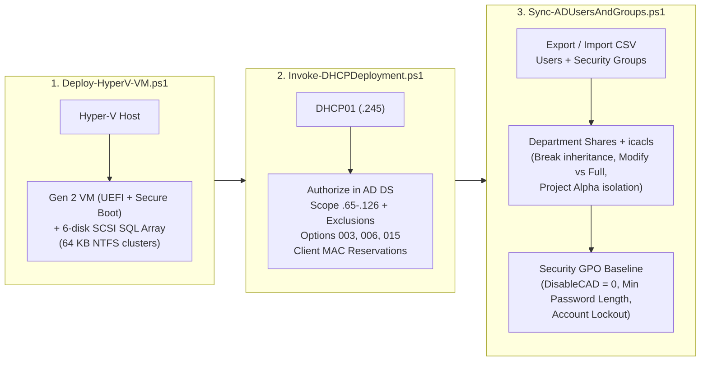

# PowerShell Infrastructure & Security Automation

Three PowerShell scripts I built to automate the repetitive Windows Server tasks we did in school:
setting up and authorizing a DHCP server (`Invoke-DHCPDeployment.ps1`), exporting and importing
Active Directory users, groups, NTFS file server permissions, and GPO baselines
(`Sync-ADUsersAndGroups.ps1`), and deploying Generation 2 Hyper-V virtual machines with a 6-disk
SCSI storage layout for SQL Server (`Deploy-HyperV-VM.ps1`).

These scripts grew directly out of two courses: our Windows Server / Active Directory PowerShell lab
(where I promoted `DC03` in `Grupp91.ps` at `192.168.91.13` and automated user migration, shared
folders with `icacls`, and GPO registry values) and our **Server Systems and Infrastructure** project
(`fjunne.local`, where we automated `DHCP01` and four SQL Server VMs). Afterwards, I cleaned up my
original lab scripts into reusable tools with parameter validation, `-WhatIf` support, `SecureString`
passwords, and clear logging.

**Courses:** Windows Server & Active Directory PowerShell Lab · Server Systems and Infrastructure ·
**Tools:** PowerShell 5.1+, `ActiveDirectory`, `GroupPolicy`, `DhcpServer`, `Hyper-V`, `Storage`,
`icacls` · **Lab Guide:** [`HyperV_VM_Automation_Lab_Guide.pdf`](HyperV_VM_Automation_Lab_Guide.pdf)

---

## Contents

- [What I built](#what-i-built)
- [How the three scripts fit together](#how-the-three-scripts-fit-together)
- [Step by step](#step-by-step)
- [Problems I ran into in the lab and how I solved them](#problems-i-ran-into-in-the-lab-and-how-i-solved-them)
- [The most important things I learned](#the-most-important-things-i-learned)
- [Files in this folder](#files-in-this-folder)

---

## What I built

- **[`Invoke-DHCPDeployment.ps1`](Invoke-DHCPDeployment.ps1):** Installs the DHCP Server role and
  RSAT tools, authorizes the server in Active Directory (`Add-DhcpServerInDC`), creates the IPv4
  scope (`192.168.23.65–126`), excludes static infrastructure IPs, sets Options `003` (Router),
  `006` (DNS), and `015` (Domain), binds MAC address reservations for clients, and clears the Server
  Manager yellow warning flag in the registry.
- **[`Sync-ADUsersAndGroups.ps1`](Sync-ADUsersAndGroups.ps1):** Exports AD users and their group
  memberships (`Get-ADPrincipalGroupMembership`) to a CSV file, imports users and creates missing
  Global Security Groups on a new DC, creates departmental folders (`Anställda`/`Employees`,
  `Ekonomi`/`Finance`, `Försäljning`/`Sales`, `Ledning`/`Executive`, and project `Alpha`), locks
  down NTFS permissions with `icacls`, and configures GPO registry settings (`Set-GPRegistryValue`).
- **[`Deploy-HyperV-VM.ps1`](Deploy-HyperV-VM.ps1):** Creates Generation 2 Hyper-V virtual machines
  with UEFI Secure Boot, attaches an OS installation ISO as the first boot device, and optionally
  builds and attaches six separate SCSI virtual disks (`Program`, `SystemDB`, `UserData`, `UserLog`,
  `tempdbData`, `tempdbLog`) along with an in-guest script that formats the database disks with a
  **64 KB NTFS allocation unit size**.

---

## How the three scripts fit together



### Overview of the scripts and the school labs behind them

| Script | Original school lab task | Key PowerShell cmdlets & tools used |
|---|---|---|
| [`Invoke-DHCPDeployment.ps1`](Invoke-DHCPDeployment.ps1) | Module L4 (`DHCP01` in `fjunne.local`, `192.168.23.0/24`) | `Install-WindowsFeature`, `Add-DhcpServerInDC`, `Add-DhcpServerv4Scope`, `Add-DhcpServerv4ExclusionRange`, `Set-DhcpServerv4OptionValue`, `Add-DhcpServerv4Reservation` |
| [`Sync-ADUsersAndGroups.ps1`](Sync-ADUsersAndGroups.ps1) | AD & GPO PowerShell Lab (`DC01` → `DC03` in `Grupp91.ps`, `192.168.91.13`) | `Get-ADUser`, `Get-ADPrincipalGroupMembership`, `New-ADGroup`, `New-ADUser`, `Add-ADGroupMember`, `icacls.exe`, `New-GPO`, `New-GPLink`, `Set-GPRegistryValue` |
| [`Deploy-HyperV-VM.ps1`](Deploy-HyperV-VM.ps1) | Module L3 (`PROD1`, `PROD2`, `RPT`, `DR` SQL Cluster VMs) | `New-VM`, `Set-VMMemory`, `Set-VMFirmware`, `Add-VMDvdDrive`, `New-VHD`, `Add-VMHardDiskDrive`, `Initialize-Disk`, `Format-Volume -AllocationUnitSize 65536` |

---

## Step by step

### 1. Promoting a DC and partitioning the file server disk with PowerShell

In the AD PowerShell lab, my first task was to build a new server (`DC03`, `192.168.91.13/24`),
promote it to a domain controller for a new forest (`Grupp91.ps`), and create a dedicated `H:`
partition on Disk 0 for user home folders (`H:\Hemkataloger`) and department shares
(`H:\Gruppkataloger`).

When I tried to create the new partition on Disk 0 with `New-Partition`, it failed because `C:` was
already using the entire disk. Instead of opening Disk Management in the GUI, I checked the minimum
and maximum supported sizes with `Get-PartitionSupportedSize`, shrank `C:` by 20 GB with
`Resize-Partition`, and then created and formatted `H:` in one pipeline:

```powershell
# Check how much C: can be shrunk and shrink it to free up space on Disk 0
$size = Get-PartitionSupportedSize -DriveLetter C
Resize-Partition -DriveLetter C -Size ($size.SizeMax - 20GB)

# Create the new H: partition on the freed space and format it as NTFS
New-Partition -DiskNumber 0 -UseMaximumSize -DriveLetter H |
    Format-Volume -FileSystem NTFS -NewFileSystemLabel "Home" -Confirm:$false

New-Item -Path "H:\Hemkataloger" -ItemType Directory
New-Item -Path "H:\Gruppkataloger" -ItemType Directory
```

**What I learned**
- Before `New-Partition` can create a volume on an existing disk, there has to be unallocated space.
  `Get-PartitionSupportedSize` tells you exactly how far Windows can safely shrink an active OS
  volume without hitting unmovable system files.

### 2. Migrating AD users and groups via CSV (`Sync-ADUsersAndGroups.ps1`)

Next, we had an existing domain controller (`DC01`) with users and security groups, and we needed to
migrate all of them over to our new domain controller (`DC03`) without recreating them by hand.

On `DC01`, I wrote a loop that fetched every user with `Get-ADUser`, looked up all the security
groups each user belonged to using `Get-ADPrincipalGroupMembership`, joined the group names into a
comma-separated string, and exported everything to `ADUsers_and_Groups.csv`:

```powershell
$users = Get-ADUser -Filter * -Property SamAccountName, GivenName, Surname, Department
$export = foreach ($user in $users) {
    $groups = (Get-ADPrincipalGroupMembership $user.SamAccountName | Select-Object -ExpandProperty Name) -join ", "
    [PSCustomObject]@{
        SamAccountName = $user.SamAccountName
        GivenName      = $user.GivenName
        Surname        = $user.Surname
        Groups         = $groups
    }
}
$export | Export-Csv -Path "C:\ADUsers_and_Groups.csv" -NoTypeInformation -Encoding UTF8
```

On `DC03`, the import part of the script reads the CSV, checks if each group in the `Groups` column
exists (and creates it with `New-ADGroup -GroupScope Global -GroupCategory Security` if it doesn't),
creates the user account with `New-ADUser`, and adds the user to each of their groups with
`Add-ADGroupMember`.

We also practiced creating a new user (`PSTest`) by copying a template user (`LedningMall`) in
PowerShell: reading the template's `MemberOf` attribute with `Get-ADUser -Identity "LedningMall" -Properties MemberOf`
and piping those groups to `Add-ADGroupMember` for the new account.

**What I learned**
- `Get-ADUser` does not return a user's group list by default, and the primary group (`Domain Users`)
  is stored separately as `PrimaryGroupID`. Using `Get-ADPrincipalGroupMembership` is much cleaner
  because it returns every group the user belongs to in one call.
- Storing multiple groups as a comma-separated string inside a single CSV column (`"Anställda, Ekonomi"`)
  and splitting it on import (`-split ',\s*'`) makes it easy to rebuild both the groups and the
  memberships in a single pass.

### 3. Locking down department and project folders with `icacls` (`Sync-ADUsersAndGroups.ps1`)

Once the users and groups existed on `DC03`, we had to create the shared folders (`Anställda`,
`Ekonomi`, `Försäljning`, `Ledning`, and a confidential project folder called `Alpha`) and set their
NTFS permissions from PowerShell using `icacls`:
- Every department group needed **Modify** (`(OI)(CI)M`) on its own folder.
- `Ledning` (Executive Management) needed **Full Control** (`(OI)(CI)F`) on the department folders.
- On the `Alpha` project folder, the `Alpha` group needed **Modify** (`(OI)(CI)M`) and the project
  lead **`Jacob.Hoover`** needed **Full Control** (`(OI)(CI)F`), while `Ledning` and other
  departments were kept out.

In [`Sync-ADUsersAndGroups.ps1`](Sync-ADUsersAndGroups.ps1), the `Invoke-NTFSHardening` function
automates this entire setup:

```powershell
# 1. Disable inheritance so permissions from the root drive do not leak in
icacls "$folderPath" /inheritance:d

# 2. Remove broad default groups
icacls "$folderPath" /remove:g "Users" "BUILTIN\Users" "Authenticated Users" "Domain Users"

# 3. Grant Modify to the department/project group and Full Control to the project lead on Alpha
icacls "$folderPath" /grant:r "$($assignedGroup):(OI)(CI)M"
icacls "$alphaPath"  /grant:r "Jacob.Hoover:(OI)(CI)F"
```

**What I learned**
- In `icacls`, **`(OI)` (Object Inherit)** and **`(CI)` (Container Inherit)** are critical. Without
  `(OI)(CI)`, the permission only applies to the top-level folder itself, and every file or subfolder
  created inside it later fails to inherit the group's access.
- Giving department members **Modify (`M`)** instead of **Full Control (`F`)** lets them create,
  edit, and delete files freely, but stops them from taking ownership or changing the ACL permissions
  on the folder.

### 4. Setting Group Policy via registry values (`Sync-ADUsersAndGroups.ps1`)

The last part of the AD PowerShell lab was creating and configuring Group Policy Objects without
opening the Group Policy Management Editor GUI. Using `New-GPO`, `New-GPLink`, and
`Set-GPRegistryValue`, I configured the security baseline directly in the GPO's registry settings,
including requiring **Ctrl+Alt+Del** at logon (`DisableCAD = 0`):

```powershell
Set-GPRegistryValue -Name $GpoName `
    -Key "HKLM\Software\Microsoft\Windows\CurrentVersion\Policies\System" `
    -ValueName "DisableCAD" `
    -Type DWORD `
    -Value 0
```

**What I learned**
- Almost every setting under *Administrative Templates* and *Windows Settings > Security Options* in
  a GPO ultimately writes a value into the Windows Registry (`Registry.pol`). Once you know the key
  path and value name (like `DisableCAD = 0`), you can script the GPO with `Set-GPRegistryValue` so
  it sets up identically every time.

### 5. Automating the DHCP server (`Invoke-DHCPDeployment.ps1`)

In Module L4 of our infrastructure course (`fjunne.local`), we were not allowed to configure our
DHCP server (`DHCP01`, `192.168.23.245`) in the GUI—everything had to be scripted in PowerShell.

My script ([`Invoke-DHCPDeployment.ps1`](Invoke-DHCPDeployment.ps1)) runs through the whole deployment:
1. Installs the `DHCP` Windows feature with management tools (`Install-WindowsFeature -Name DHCP -IncludeManagementTools`).
2. Authorizes `DHCP01.fjunne.local` (`192.168.23.245`) in Active Directory (`Add-DhcpServerInDC`).
3. Creates the active IPv4 scope (`192.168.23.65` to `192.168.23.126`, mask `255.255.255.0`).
4. Excludes static infrastructure addresses (`192.168.23.1–10`, cluster VIPs `.50` and `.60`, switch
   `.240`, servers `.244–.254`).
5. Sets standard DHCP options (`Set-DhcpServerv4OptionValue`):
   - **Option 003 (Router):** `192.168.23.1`
   - **Option 006 (DNS Servers):** `192.168.23.254`, `192.168.23.253`
   - **Option 015 (DNS Domain Name):** `fjunne.local`
6. Registers MAC reservations (`Add-DhcpServerv4Reservation`) so `Klient01` (`00-15-5D-68-48-00`),
   `Klient02` (`00-15-5D-68-49-00`), and `Klient03` (`00-15-5D-68-46-00`) always get `.65`, `.66`,
   and `.67`.
7. Sets `ConfigurationState = 2` under `HKLM:\SOFTWARE\Microsoft\ServerManager\Roles\12` to clear
   Server Manager's post-install warning banner.

```powershell
.\Invoke-DHCPDeployment.ps1 -ScopeId "192.168.23.0" -ScopeName "Fjunne-LAN" `
    -StartRange "192.168.23.65" -EndRange "192.168.23.126" `
    -Gateway "192.168.23.1" -DnsServers @("192.168.23.254", "192.168.23.253") `
    -DnsDomainName "fjunne.local" -DnsName "DHCP01.fjunne.local" `
    -IPAddress "192.168.23.245" -AuthorizeInAD -WhatIf
```

**What I learned**
- **AD authorization (`Add-DhcpServerInDC`) is a built-in security control.** A Windows DHCP server
  joined to a domain checks with Active Directory when it starts. If its IP and FQDN are not on the
  authorized list in AD, it refuses to hand out leases—which protects the network against someone
  accidentally spinning up a rogue Windows DHCP server.
- Even after you configure a scope and authorize DHCP via PowerShell, Server Manager keeps showing a
  yellow exclamation mark until you flip `ConfigurationState` from `1` to `2` in the registry.

### 6. Automating Generation 2 Hyper-V VMs and 6-disk SQL arrays (`Deploy-HyperV-VM.ps1`)

When we built our four SQL Server cluster nodes (`PROD1`, `PROD2`, `RPT`, `DR`), each VM needed an
OS disk plus six separate SCSI disks (`Program`, `SystemDB`, `UserData`, `UserLog`, `tempdbData`,
`tempdbLog`). Doing that by hand in Hyper-V Manager means clicking through the *New Virtual Hard
Disk* wizard 24 times across four servers.

[`Deploy-HyperV-VM.ps1`](Deploy-HyperV-VM.ps1) automates the entire VM build:
1. Creates a **Generation 2** VM (`New-VM -Generation 2`) and connects it to the virtual switch.
2. Configures vCPUs, RAM, and **UEFI Secure Boot** (`Set-VMFirmware -EnableSecureBoot On`).
3. Mounts the Windows Server ISO to a virtual DVD drive and sets the DVD drive as the first UEFI
   boot device (`Set-VMFirmware -FirstBootDevice $dvd`).
4. When `-ProvisionDatabaseArray` is passed, loops through the 6 SQL disk roles, creates each `.vhdx`
   with `New-VHD`, and attaches it to **SCSI Controller 0** on LUNs `1` through `6`.
5. Generates a companion script (`Initialize-GuestDatabaseDisks.ps1`) to run inside the guest OS that
   initializes the raw disks as GPT and formats the SQL data/log volumes with a **64 KB allocation
   unit size** (`-AllocationUnitSize 65536`).

```powershell
.\Deploy-HyperV-VM.ps1 -VMName "PROD2" -MemoryStartupBytes 4GB -ProcessorCount 2 `
    -SwitchName "ExternalSwitch" -IsoPath "D:\ISOs\WinServer2019.iso" `
    -ProvisionDatabaseArray -StartVM
```

**What I learned**
- On a Generation 2 VM, all disks (including the OS disk and DVD drive) attach to the **SCSI
  controller** instead of legacy IDE, which is faster and lets you hot-add storage while the VM is
  running.
- Formatting SQL database and log volumes with **64 KB NTFS clusters (`65536` bytes)** matches SQL
  Server's internal 64 KB extent size (eight 8 KB pages) and avoids split I/O operations.

---

## Problems I ran into in the lab and how I solved them

| Problem | Cause | Solution |
|---|---|---|
| `Install-ADDSForest` failed with *"The NetBIOS name Grupp91 is already in use"* | Another group on the shared classroom lab network was already broadcasting the NetBIOS name `Grupp91` | Uninstalling AD DS did not help because the name collision was on the wire; changing `-DomainNetbiosName` to `"Gr91"` solved it immediately |
| `New-Partition` failed when creating the `H:` drive on `DC03` | The `C:` partition took up 100% of Disk 0, leaving 0 bytes of unallocated space | Checked `Get-PartitionSupportedSize -DriveLetter C` and shrank `C:` by 20 GB with `Resize-Partition` before running `New-Partition` |
| `DHCP01` installed fine via PowerShell, but clients got `169.254.x.x` (APIPA) | The DHCP service was installed and the scope existed, but the server was not authorized in Active Directory yet | Ran `Add-DhcpServerInDC -DnsName "DHCP01.fjunne.local" -IPAddress 192.168.23.245` so AD allowed the service to answer `DHCPDISCOVER` broadcasts |
| Server Manager still showed a yellow *"Post-deployment configuration required"* alert on `DHCP01` | PowerShell cmdlets configure the DHCP engine directly without notifying the Server Manager GUI wizard | Set `HKLM:\SOFTWARE\Microsoft\ServerManager\Roles\12` -> `ConfigurationState = 2` in the script |
| Users in a department could open their shared folder, but could not access files inside subfolders | Early `icacls` command granted `M` (Modify) without the `(OI)(CI)` inheritance flags | Changed the grant string to `"$($group):(OI)(CI)M"` so permissions inherit down to all files and subfolders |

---

## The most important things I learned

- **If you have to build it more than once, script it.** Clicking through 24 virtual disks or typing
  20 DHCP exclusions by hand is slow and guarantees a typo somewhere. A PowerShell script does it in
  seconds and documents the exact setup at the same time.
- **Make scripts safe to run twice (idempotency) and support `-WhatIf`.** In the lab I often had to
  re-run a script after fixing one step halfway through. Checking `Get-ADUser`, `Get-DhcpServerv4Scope`,
  or `Get-VM` before creating objects—and adding `SupportsShouldProcess` (`-WhatIf`)—lets you test
  and re-run scripts without breaking what is already there.
- **Never hardcode plaintext passwords in scripts.** Using `[System.Security.SecureString]` parameters
  or generating random passwords with `System.Security.Cryptography.RandomNumberGenerator` keeps
  credentials out of Git history.

---

## Files in this folder

```
04-powershell-infrastructure-automation/
├── README.md                                <- This overview
├── Invoke-DHCPDeployment.ps1                <- Automated DHCP installation, AD authorization, scopes & reservations
├── Sync-ADUsersAndGroups.ps1                <- AD CSV user/group sync, icacls NTFS hardening & GPO baseline script
├── Deploy-HyperV-VM.ps1                     <- Gen 2 Hyper-V VM & 6-disk SQL SCSI storage provisioning script
└── HyperV_VM_Automation_Lab_Guide.pdf       <- Original Swedish lab guide & documentation
```
