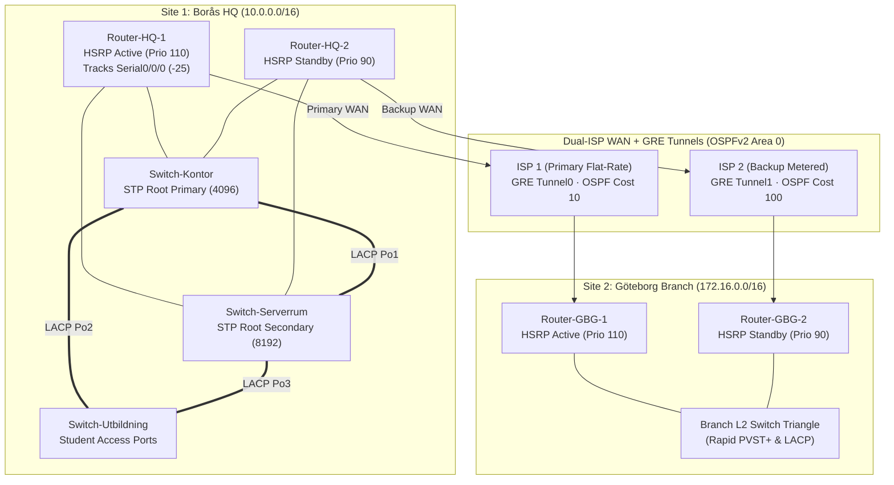
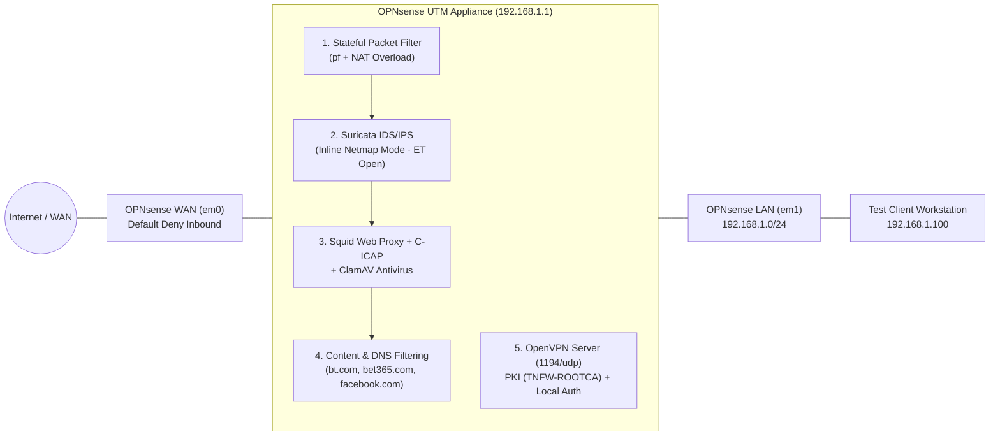

# Enterprise Network Architecture & OPNsense UTM Firewall

Two networking and perimeter security projects from school that belong together:
1. **Part 1 — Multi-Site School Network (Borås & Göteborg):** We designed and built a fault-tolerant
   network for a school with two campuses (`10.0.0.0/16` in Borås and `172.16.0.0/16` in Göteborg),
   first in Cisco Packet Tracer and then on physical Cisco routers and switches in the lab rack.
2. **Part 2 — Building a UTM Firewall with OPNsense:** We turned a dual-NIC PC into a Unified Threat
   Management (UTM) firewall for a small office (20–50 workstations) using **OPNsense**, setting up
   stateful firewall rules, Suricata IDS/IPS, ClamAV web proxy antivirus, DNS/URL content filtering,
   and an OpenVPN remote-access server.

**Courses:** Network Design & Routing (HT24) · Firewall & Perimeter Security (Lab 2a–2c) ·
**Tools:** Cisco IOS CLI, Cisco Packet Tracer, OPNsense (FreeBSD), Suricata IPS, Squid + C-ICAP +
ClamAV, Unbound DNSBL, OpenVPN · **Reports:**
[`MultiSite_Enterprise_Network_Design.pdf`](MultiSite_Enterprise_Network_Design.pdf) ·
[`OPNsense_UTM_Firewall_Implementation.pdf`](OPNsense_UTM_Firewall_Implementation.pdf)

---

## Contents

- [Part 1: Multi-site school network (Borås & Göteborg)](#part-1-multi-site-school-network-borås--göteborg)
  - [What we built](#what-we-built)
  - [Topology and VLSM address plan](#topology-and-vlsm-address-plan)
  - [Step by step (Part 1)](#step-by-step-part-1)
- [Part 2: Building a UTM firewall with OPNsense](#part-2-building-a-utm-firewall-with-opnsense)
  - [What we built](#what-we-built-1)
  - [UTM architecture](#utm-architecture)
  - [Step by step (Part 2)](#step-by-step-part-2)
- [Problems we ran into and how we solved them](#problems-we-ran-into-and-how-we-solved-them)
- [The most important things I learned](#the-most-important-things-i-learned)
- [Files in this folder](#files-in-this-folder)

---

# Part 1: Multi-site school network (Borås & Göteborg)

In this assignment, a school with campuses in **Borås (Site 1)** and **Göteborg (Site 2)** needed a
new network design that could survive a broken cable, a dead switch, a failed border router, or an
ISP outage—while keeping students strictly separated from the Finance department, Management, and
internal servers.

## What we built

- **VLSM subnetting across two sites:** Split `10.0.0.0/16` (Borås) and `172.16.0.0/16` (Göteborg)
  into right-sized VLAN subnets for Students (up to 2,000 hosts at HQ and 500 at the branch),
  Teachers, Finance, Management, Servers, and a DMZ
- **Layer 2 redundancy:** Connected three switches per site in a triangle with **LACP (`802.3ad`)**
  port-channels and **Rapid PVST+ (`802.1w`)** with explicit primary and secondary root bridge
  priorities
- **First-hop gateway redundancy:** Configured **HSRPv2** (`standby version 2`) across two border
  routers per site with interface tracking (`standby track Serial0/0/0 25`) so the virtual gateway
  automatically fails over if the primary WAN link drops
- **Dual-ISP WAN and GRE + OSPFv2 routing:** Built point-to-point **GRE tunnels** over two separate
  ISP links (fast flat-rate ISP 1 as primary with OSPF cost `10`, metered ISP 2 as backup with OSPF
  cost `100`) so private VLANs on both campuses can talk to each other
- **Extended ACLs:** Blocked the Student VLANs from reaching Finance, Management SVIs, and internal
  servers while still allowing internet access and public DMZ services

---

## Topology and VLSM address plan



### Site 1 — Borås HQ (`10.0.0.0/16`)

| VLAN | Department / Zone | Subnet | Mask | Usable Hosts | HSRP Virtual Gateway (`.1`) |
|---|---|---|---|---|---|
| `VLAN 10` | Students (`Utbildning`) | `10.0.8.0/21` | `255.255.248.0` | 2,046 (req: 2,000) | `10.0.8.1` |
| `VLAN 20` | Teachers / Faculty | `10.0.1.0/24` | `255.255.255.0` | 254 (req: 80) | `10.0.1.1` |
| `VLAN 30` | Finance (`Ekonomi`) | `10.0.2.0/24` | `255.255.255.0` | 254 (req: 25) | `10.0.2.1` |
| `VLAN 40` | Management (`Ledning`) | `10.0.3.0/24` | `255.255.255.0` | 254 | `10.0.3.1` |
| `VLAN 50` | Server Room | `10.0.4.0/24` | `255.255.255.0` | 254 | `10.0.4.1` |
| `VLAN 60` | DMZ (Public Web/Mail) | `10.0.5.0/24` | `255.255.255.0` | 254 | `10.0.5.1` |

### Site 2 — Göteborg Branch (`172.16.0.0/16`)

| VLAN | Department / Zone | Subnet | Mask | Usable Hosts | HSRP Virtual Gateway (`.1`) |
|---|---|---|---|---|---|
| `VLAN 50` | Students (`Utbildning`) | `172.16.4.0/23` | `255.255.254.0` | 510 (req: 500) | `172.16.4.1` |
| `VLAN 60` | Teachers / Faculty | `172.16.1.0/24` | `255.255.255.0` | 254 (req: 40) | `172.16.1.1` |
| `VLAN 70` | Finance (`Ekonomi`) | `172.16.2.0/24` | `255.255.255.0` | 254 (req: 15) | `172.16.2.1` |
| `VLAN 80` | Management (`Ledning`) | `172.16.3.0/24` | `255.255.255.0` | 254 | `172.16.3.1` |
| `VLAN 90` | Local Branch Servers | `172.16.6.0/24` | `255.255.255.0` | 254 | `172.16.6.1` |
| `VLAN 100` | Branch DMZ | `172.16.7.0/24` | `255.255.255.0` | 254 | `172.16.7.1` |

---

## Step by step (Part 1)

### 1. VLSM subnetting and VLAN segmentation

Before touching any cables or CLI commands, we calculated the subnet sizes for each group of users.
In Borås, the student network needed room for 2,000 devices (`2^11 - 2 = 2,046` hosts, which gives a
`/21` mask: `255.255.248.0`), while Göteborg needed 500 student devices (`2^9 - 2 = 510` hosts, a
`/23` mask: `255.255.254.0`). Staff departments, servers, and the DMZ got clean `/24` subnets so
each zone was easy to read in firewall and ACL rules.

**What I learned**
- **Always align big VLSM blocks on clean bit boundaries.** Starting the `/21` student block at
  `10.0.8.0/21` (`10.0.8.1` – `10.0.15.254`) leaves `10.0.1.0/24` through `10.0.7.0/24` free for
  the smaller `/24` department VLANs without any overlapping ranges.

### 2. Switch triangle, LACP EtherChannels, and Rapid PVST+

At each site, we connected three switches (`Switch-Kontor`, `Switch-Serverrum`, `Switch-Utbildning`)
in a triangle with dual links between each pair bundled into **LACP (`802.3ad`)** port-channels
(`channel-group 1 mode active`). We enabled **Rapid PVST+** (`spanning-tree mode rapid-pvst`) and
set the root bridge explicitly instead of leaving it to chance:

```ios
spanning-tree mode rapid-pvst
spanning-tree vlan 10,20,30,40,50,60 priority 4096
! On access ports for PCs:
interface range FastEthernet0/1 - 20
 spanning-tree portfast
 spanning-tree bpduguard enable
```

**What I learned**
- If you leave Spanning Tree priorities at the default (`32768`), the switch with the lowest MAC
  address wins the root bridge election—which is often the oldest, slowest switch in the building!
  Setting priority `4096` on `Switch-Kontor` and `8192` on `Switch-Serverrum` guarantees that traffic
  always flows through the core switches.
- Bundling two physical cables into an **LACP Port-Channel** makes Spanning Tree see them as a single
  logical link, so you get double the bandwidth *and* sub-second failover if one cable is unplugged,
  without waiting for STP to recalculate.

### 3. Router redundancy with HSRPv2 and interface tracking

Each site had two border routers (`Router-1` connected to primary ISP 1, `Router-2` connected to
backup ISP 2). On the LAN subinterfaces (`GigabitEthernet0/0.<vlan>`), we configured **HSRPv2** so
clients always used the `.1` virtual IP as their default gateway while `.2` (`Router-1`) and `.3`
(`Router-2`) were the physical router IPs:

```ios
interface GigabitEthernet0/0.10
 encapsulation dot1Q 10
 ip address 10.0.8.2 255.255.248.0
 standby version 2
 standby 10 ip 10.0.8.1
 standby 10 priority 110
 standby 10 preempt
 standby 10 track Serial0/0/0 25
```

**What I learned**
- **HSRP without WAN tracking creates a black hole.** If `Router-1`'s WAN cable (`Serial0/0/0`) goes
  down while its LAN port stays up, `Router-1` will keep holding the `.1` gateway IP even though it
  has no internet connection! Adding `standby 10 track Serial0/0/0 25` drops `Router-1`'s priority
  from `110` to `85` (below `Router-2`'s `90`), so `Router-2` with `preempt` immediately takes over
  the `.1` gateway.

### 4. Connecting Borås and Göteborg with GRE tunnels and OSPFv2

Because the two campuses were separated by public ISP networks that do not route private RFC 1918
addresses (`10.0.0.0/16` and `172.16.0.0/16`), we created point-to-point **GRE tunnels** (`Tunnel0`
over ISP 1 and `Tunnel1` over ISP 2) between Borås and Göteborg and ran **OSPFv2** across the
tunnels:

```ios
interface Tunnel0
 ip address 10.255.0.1 255.255.255.252
 ip mtu 1476
 ip tcp adjust-mss 1436
 ip ospf cost 10
 tunnel source Serial0/0/0
 tunnel destination 150.150.0.2
```

According to the assignment rules, ISP 1 was a fast flat-rate connection, while ISP 2 was a slow
metered connection where the school had to pay per megabyte transferred. By setting `ip ospf cost 10`
on the primary tunnel and `ip ospf cost 100` on the backup tunnel, 100% of traffic stayed on the
free primary link unless ISP 1 went down.

**What I learned**
- GRE adds a 24-byte header (`20` bytes IP + `4` bytes GRE) to every packet. Lowering the tunnel MTU
  to `1476` and clamping TCP MSS to `1436` stops large packets from fragmenting across the WAN.
- Running `passive-interface default` under `router ospf 1` and only enabling OSPF hellos on the
  router-to-router links stops anyone in the student VLAN from plugging in a laptop, speaking OSPF,
  and injecting fake routes.

### 5. Locking down the Student VLANs with Extended ACLs

Finally, we wrote **Extended IP Access Control Lists** on the routers to enforce the security policy:
- Students (`10.0.8.0/21` and `172.16.4.0/23`) were blocked from reaching Finance, Management, the
  internal server VLANs, and the switches' management SVIs (`deny ip ...`).
- Management (`Ledning`) could reach all internal networks, and only administrator IPs were allowed
  to connect to the routers and switches on VTY lines (`access-class` over SSH).

---

# Part 2: Building a UTM firewall with OPNsense

In our firewall course (**Lab 2a, 2b, and 2c**), our assignment was to build a low-cost **Unified
Threat Management (UTM)** firewall for a small business (20–50 workstations) using open-source
software on a standard PC with two network cards (`em0` WAN and `em1` LAN), and test five security
features in practice.

## What we built

- Installed **OPNsense** (FreeBSD/ZFS) on a dual-NIC PC (`192.168.1.1/24` on LAN, DHCP on WAN)
- Configured **stateful packet filtering** with default-deny inbound on WAN and granular outbound
  rules on LAN
- Enabled **Suricata IDS/IPS** in inline **IPS mode** (Netmap) with Emerging Threats (`ET Open`)
  rules to drop malicious packets in real time
- Set up the **Squid Web Proxy** integrated with **C-ICAP** and **ClamAV** to scan HTTP downloads
  for malware at the gateway
- Tested **web & content filtering** against three target sites required by the lab (`bt.com`,
  `bet365.com`, and `facebook.com`) and solved the HTTPS filtering limitation using DNS blackholing
- Built an internal **Certificate Authority (`TNFW-ROOTCA`)** and configured an **OpenVPN** server
  with TLS + user authentication for remote workers

---

## UTM architecture



---

## Step by step (Part 2)

### 1. Installing OPNsense and stateful firewall rules

We booted the target PC from the OPNsense installer USB, assigned the two network interfaces (`em0`
as WAN and `em1` as LAN at `192.168.1.1/24`), and completed the initial setup through the web GUI
from our test client (`192.168.1.100`).

We verified how OPNsense's stateful packet filter (`pf`) works: all incoming connections initiated
from the WAN are blocked by default, while outbound connections from the LAN create a state entry
in the state table so return packets are allowed back in automatically.

**What I learned**
- Locking the OPNsense web GUI (`443/tcp`) and SSH exclusively to the LAN interface (or a dedicated
  management VLAN) and disabling the default anti-lockout rule once proper admin rules are in place
  keeps the firewall's management plane invisible from the internet.

### 2. Intrusion Prevention with Suricata (IDS vs. IPS)

Under *Services > Intrusion Detection*, we enabled **Suricata**, downloaded the **ET Open (Emerging
Threats)** rulesets (`emerging-malware`, `emerging-exploit`, `emerging-scan`, `emerging-dos`), and
switched Suricata from passive **IDS mode** (which only logs alerts) to inline **IPS mode** (which
uses FreeBSD Netmap to sit directly in the packet path) with policy actions changed from *Alert* to
*Drop*.

**What I learned**
- In **IDS mode**, Suricata works on a copy of the packet, so by the time an alert shows up in the
  log, the exploit packet has already reached the server. Switching to **IPS mode** lets Suricata
  drop the offending packet before it ever leaves the firewall interface.

### 3. Gateway Antivirus with Squid Proxy + C-ICAP + ClamAV

To scan files for viruses as users download them, we installed the `os-clamav` and `os-c-icap`
plugins and connected them to OPNsense's **Squid** caching web proxy. When a client downloads a file
over HTTP through the proxy, Squid streams the payload over the ICAP protocol (`127.0.0.1:1344`) to
ClamAV. If ClamAV matches a malware signature (tested with the standard **EICAR** test file), the
proxy blocks the download and shows an infection warning page instead of delivering the file.

### 4. Content filtering: blocking `bt.com`, `bet365.com`, and `facebook.com`

In Lab 2b, we had to block three specific websites from the client workstation: **`bt.com`**,
**`bet365.com`**, and **`facebook.com`**, as well as whole categories like gambling and social media
using the UT1 / Shallalist blacklists.

When we first configured URL filtering inside the standard HTTP proxy (`3128/tcp`), we noticed an
important problem: plain HTTP requests were blocked cleanly, but modern **HTTPS (`443/tcp`)** sites
like `facebook.com` bypassed the HTTP proxy unless the client's browser was explicitly pointed at
the proxy *or* TLS inspection / DNS filtering was used!

We solved this in two ways:
1. Configured proxy access control lists (ACLs) blocking both `HTTP` and `HTTPS CONNECT` requests
   for `bt.com`, `bet365.com`, and `facebook.com`.
2. Enabled **Unbound DNSBL (DNS Blacklist)** on OPNsense (`53/udp`) and blocked external DNS ports on
   the firewall so clients had to use OPNsense for DNS—returning `0.0.0.0` / `NXDOMAIN` for blocked
   domains regardless of whether they used HTTP or HTTPS.

**What I learned**
- A transparent **HTTP proxy on port 80 cannot see inside HTTPS on port 443** without installing a
  custom root CA certificate on every client machine (SSL/TLS Man-in-the-Middle bump), which often
  breaks HSTS on sites like `facebook.com`.
- Combining **DNSBL (Unbound)** with firewall rules that block clients from bypassing the local DNS
  server (`8.8.8.8` / DoT) is a much cleaner way to block unwanted domains across a small office
  network without breaking browser certificates.

### 5. Remote access VPN with OpenVPN and a local Certificate Authority

Finally, we set up **OpenVPN** so employees could connect securely from outside the office:
1. Under *System > Trust > Authorities*, we created an internal Root CA (`TNFW-ROOTCA`).
2. Created a server certificate for the firewall and a client certificate for our test user.
3. Configured the OpenVPN server on UDP port `1194` (`10.0.8.0/24` tunnel network) requiring
   **both** a valid client certificate and a local username/password (`Local Database + TLS`).
4. Exported the `.ovpn` client bundle and tested connecting into the LAN from the outside.

---

## Problems we ran into and how we solved them

| Problem | Cause | Solution |
|---|---|---|
| OSPF neighbors between Borås and Göteborg kept dropping over the GRE tunnel | We accidentally included the tunnel's public WAN destination IP inside the OSPF network statements, causing recursive routing (the tunnel tried to route through itself!) | Excluded the public WAN `/30` subnets from OSPF so the router always reached the tunnel endpoint via the static ISP route |
| HSRP did not fail over when we unplugged `Router-1`'s WAN serial cable in Packet Tracer | `Router-1`'s LAN port (`Gi0/0`) was still up, so its HSRP priority stayed at `110` | Added `standby <group> track Serial0/0/0 25` so losing the WAN link lowers `Router-1`'s priority to `85`, letting `Router-2` (`90`) preempt it |
| Student PCs got blocked from browsing the web after we applied our Extended ACL | We put `deny ip 10.0.8.0 0.0.7.255 any` at the end instead of only denying the internal private subnets | Changed the ACL to explicitly `deny` the internal department/server subnets first and `permit ip 10.0.8.0 0.0.7.255 any` at the end for internet NAT |
| `facebook.com` still loaded over HTTPS when we only used transparent HTTP proxy filtering on OPNsense | Transparent HTTP proxies only intercept port `80`; HTTPS runs encrypted on port `443` | Blocked the domains in both the HTTPS proxy ACL (`CONNECT`) and **Unbound DNSBL**, and blocked clients from using external DNS servers |
| ClamAV service failed to start right after installing `os-clamav` | The signature database (`/var/db/clamav`) is empty on a fresh install until `freshclam` finishes its first download | Ran the signature update (`freshclam`), waited for the `.cvd` files to finish downloading, and then started `clamd` and `c-icap` |

---

## The most important things I learned

- **Redundancy has to cover every layer—and every layer needs to know when the one above it fails.**
  Having two switches with LACP and two routers with HSRP is great, but without `standby track` on
  the WAN interface, traffic still gets sent to a router whose internet cable is unplugged.
- **OSPF costs let you turn business rules into routing decisions.** Setting cost `10` on the
  flat-rate ISP tunnel and cost `100` on the metered backup tunnel made sure the backup link cost
  the school zero kronor during normal operation, while still taking over automatically during an
  outage.
- **Open-source OPNsense can replace an expensive commercial UTM box for a small office.** Running
  stateful `pf`, Suricata IPS, ClamAV, DNSBL, and OpenVPN on a standard dual-NIC PC gave us the same
  core capabilities as a commercial firewall without per-seat licensing fees.

---

## Files in this folder

```
05-enterprise-network-architecture/
├── README.md                                       <- This overview
├── MultiSite_Enterprise_Network_Design.pdf         <- Part 1: Dual-site Cisco network report (Borås & Göteborg)
└── OPNsense_UTM_Firewall_Implementation.pdf        <- Part 2: OPNsense UTM firewall lab report (Lab 2a-2c)
```
