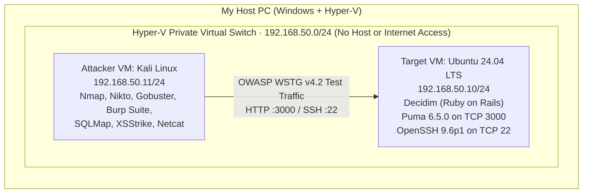

# Web Application Penetration Testing (OWASP WSTG — Decidim)

A web application penetration test that I performed against **Decidim**—an open-source digital
democracy and citizen participation platform built on **Ruby on Rails** and **Puma 6.5.0**—following
the **OWASP Web Security Testing Guide (WSTG v4.2)**.

To test safely without touching any external network, I built an isolated two-VM lab in Hyper-V connected
by a **Private Virtual Switch (`192.168.50.0/24`)**: an Ubuntu 24.04 LTS server hosting Decidim on
`192.168.50.10:3000` and a Kali Linux attacker machine on `192.168.50.11`. I worked through
reconnaissance, directory enumeration, error handling, login brute-forcing, session management, IDOR,
XSS, and SQL injection, documenting both the vulnerabilities I found and the security controls in
Rails that held up under testing.

**Methodology:** OWASP Web Security Testing Guide (WSTG v4.2) · **Target:** Decidim (Ruby on Rails /
Puma 6.5.0 on Ubuntu 24.04 LTS) · **Tools:** Kali Linux, Nmap, Nikto, Gobuster, Burp Suite, SQLMap,
XSStrike, cURL, Netcat · **Full report (36 pages, Swedish):**
[`Web_Application_Penetration_Testing_Report.pdf`](Web_Application_Penetration_Testing_Report.pdf)

---

## Contents

- [What I did](#what-i-did)
- [Isolated lab topology](#isolated-lab-topology)
- [Summary of OWASP WSTG test results](#summary-of-owasp-wstg-test-results)
- [Step by step](#step-by-step)
- [Vulnerabilities I found and how to fix them](#vulnerabilities-i-found-and-how-to-fix-them)
- [The most important things I learned](#the-most-important-things-i-learned)
- [Files in this folder](#files-in-this-folder)

---

## What I did

- Built an **isolated pentest lab** in Hyper-V using a **Private Virtual Switch** (`192.168.50.0/24`)
  so all attack traffic stayed strictly between Kali (`192.168.50.11`) and the Ubuntu target server
  (`192.168.50.10`)
- Ran **service and web server fingerprinting** with `nmap` and `nikto`, and mapped hidden routes
  with `gobuster` (finding the super-admin login portal `/system/admins/sign_in`)
- Triggered a **verbose stack trace leak** (`WSTG-ERR-01`) by sending a malformed HTTP request
  (`GET / GOLD ERROR/1.0`), exposing internal file paths and Ruby gem versions
- Tested the login form with **Burp Suite Intruder** (`WSTG-ATHN-03`) and proved that the app had
  **no rate limiting or account lockout** against brute-force password attacks
- Captured **cleartext credentials and password reset tokens** (`WSTG-ATHN-01`) in Burp Proxy because
  Puma was serving HTTP directly on port `3000` without a TLS reverse proxy
- Tested **session cookies, IDOR (`/users/1`, `/users/2`), XSS (`XSStrike`), and SQL injection
  (`SQLMap --level 5`)**, verifying how Ruby on Rails' built-in protections (`HttpOnly`, `SameSite`,
  CSRF authenticity tokens, context-aware HTML escaping, and parameterized ActiveRecord queries)
  stopped those attacks

---

## Isolated lab topology



### Virtual machines in the lab

| Machine | IP Address | OS & Software Stack | Role |
|---|---|---|---|
| **Target Server** | `192.168.50.10/24` | Ubuntu 24.04 LTS · Ruby 3.x (`rbenv`) · Ruby on Rails · Puma `6.5.0` (`3000/tcp`) · PostgreSQL · OpenSSH `9.6p1` (`22/tcp`) | Hosts the Decidim web application |
| **Attacker Machine** | `192.168.50.11/24` | Kali Linux · Nmap · Nikto · Gobuster · Burp Suite Community · SQLMap · XSStrike · cURL · Netcat | Used to run all OWASP WSTG reconnaissance and exploitation tests |

---

## Summary of OWASP WSTG test results

| WSTG ID | Test Category | What I tested | Tools used | Result |
|---|---|---|---|---|
| `WSTG-INFO-01` / `02` | Reconnaissance & Fingerprinting | Full port scan, service banners, HTTP headers (`Puma 6.5.0`) | `nmap`, `curl -I`, `nikto` | **Info:** Server version exposed in headers |
| `WSTG-INFO-03` | Metadata & Sensitive Files | Checked `/robots.txt`, `/.env`, `/config/database.yml`, `/Gemfile.lock` | Browser, `curl` | **Secure:** Sensitive files blocked (`403` / `404`) |
| `WSTG-INFO-04` | Directory & Route Enumeration | Brute-forced paths with `common.txt` wordlist | `gobuster dir` | **Info:** Found `/system/admins/sign_in`, `/users/sign_in`, `/processes` |
| `WSTG-ERR-01` | Improper Error Handling | Sent malformed HTTP protocol string (`GET / GOLD ERROR/1.0`) | `nc` (Netcat), `curl` | **Vulnerable (Medium):** Returned full Rails/Puma stack trace |
| `WSTG-ATHN-01` | Credentials Over Unencrypted Channel | Intercepted `POST /users/sign_in` and `/users/password` | Burp Suite Proxy | **Vulnerable (Medium):** Passwords & tokens sent over plain HTTP |
| `WSTG-ATHN-03` | Weak Lockout / Brute Force | Ran automated password-guessing payloads against `/users/sign_in` | Burp Suite Intruder | **Vulnerable (Medium):** No rate limiting, CAPTCHA, or account lockout |
| `WSTG-ATHN-04` | Authentication Bypass | Tried accessing `/admin` and `/system` without logging in | Browser, `curl -i` | **Secure:** Enforced `302 Found` redirect to login page |
| `WSTG-ATHZ-02` | Insecure Direct Object Reference (IDOR) | Modified user IDs (`/users/1`, `/users/2`) and forged cookies | Browser, `curl -b` | **Secure:** Forged sessions rejected; only public profile fields shown |
| `WSTG-SESS-01` | Session Management & Fixation | Checked `_decidim_session` cookie flags and ID rotation at login | DevTools, Burp Suite | **Secure:** `HttpOnly` & `SameSite=Lax` set; session ID rotated on login |
| `WSTG-INPV-01` / `02` | Reflected & Stored XSS | Injected `<script>` and event-handler payloads into search and comments | `XSStrike`, Burp Suite | **Secure:** Rails escaped `<`, `>`, `"`, `'` into HTML entities |
| `WSTG-INPV-05` | SQL Injection (SQLi) | Tested login parameters (`user[email]`, `user[password]`) and URL params | `sqlmap --level 5`, manual `' OR '1'='1` | **Secure:** ActiveRecord parameterized queries blocked SQL injection |
| `WSTG-INPV-07` | HTTP Parameter Pollution (HPP) | Sent duplicate query parameters (`?id=1&id=2`) | `curl`, Browser | **Secure:** Handled cleanly without crashes or auth bypass |

---

## Step by step

### 1. Building the isolated lab on a Hyper-V Private Switch

Before installing Decidim or running any scanning tools, I created a **Private Virtual Switch** in
Hyper-V Manager and attached both the Ubuntu server (`192.168.50.10`) and Kali Linux
(`192.168.50.11`) to it. On Ubuntu, I installed Ruby via `rbenv`, PostgreSQL, and Node/Yarn, and
started the Decidim server bound to `0.0.0.0:3000`.

**What I learned**
- In my Active Directory lab (`07`), I used an *Internal* switch with NAT because the VMs needed
  internet access through my laptop. For a penetration testing lab where you run aggressive tools
  like `sqlmap`, `nikto`, and `gobuster`, a **Private** switch is better once the target is installed:
  not even the host laptop has a network adapter on a Private switch, so attack traffic cannot
  accidentally hit your host machine or your home router.

### 2. Reconnaissance, fingerprinting, and route discovery (`WSTG-INFO-01` to `04`)

From Kali (`192.168.50.11`), I started with a full TCP port and version scan using `nmap`, followed
by `curl -I` and `nikto`:

```bash
nmap -sS -sV -p- 192.168.50.10
curl -I http://192.168.50.10:3000
nikto -h http://192.168.50.10:3000
```

Only two ports were open: `22/tcp` (`OpenSSH 9.6p1`) and `3000/tcp` (`Puma 6.5.0`). Checking
`/robots.txt` and manually requesting sensitive Ruby on Rails files (`/.env`, `/config/database.yml`,
`/Gemfile`, `/Gemfile.lock`, `/log/development.log`) confirmed that Rails was not serving raw project
files from disk (`404 Not Found` / `403 Forbidden`).

Next, I ran `gobuster` with `/usr/share/wordlists/dirb/common.txt` to find hidden application
paths:

```bash
gobuster dir -u http://192.168.50.10:3000 -w /usr/share/wordlists/dirb/common.txt
```

Alongside the normal `/users/sign_in` and `/processes` pages, Gobuster discovered
**`/system/admins/sign_in`**—Decidim's separate multi-tenant system administrator login page, which is
not linked anywhere in the public navigation menu.

**What I learned**
- Directory enumeration (`gobuster`) is not just about looking for forgotten `.bak` or `.zip` files;
  in modern MVC frameworks like Rails, it uncovers **routes** (like `/system/admins/sign_in`) that
  give an attacker a high-value administrative login target.

### 3. Triggering a stack trace with malformed HTTP (`WSTG-ERR-01`)

To test how the web server handled unexpected or broken protocol input, I used Netcat (`nc`) and
`curl` to send a malformed HTTP request line (`GET / GOLD ERROR/1.0`) to port `3000`:

```bash
printf "GET / GOLD ERROR/1.0\r\nHost: 192.168.50.10:3000\r\n\r\n" | nc 192.168.50.10 3000
```

Instead of returning a generic `400 Bad Request` page, Puma and Rails returned a detailed diagnostic
error page containing a **full stack trace**: exact file paths on the Ubuntu server
(`/home/.../.rbenv/versions/...`), internal gem versions, and the middleware chain.

**What I learned**
- Running a web app with development/debug error pages enabled (`config.consider_all_requests_local = true`
  in Rails) gives an attacker a free map of your server's directory layout and exact library
  versions, which makes finding matching CVEs much easier.

### 4. Testing authentication: cleartext HTTP and Burp Intruder brute force (`WSTG-ATHN-01` & `03`)

Next, I routed Kali's browser through **Burp Suite Proxy** and logged into `/users/sign_in` and
`/system/admins/sign_in`. Looking at the captured `POST /users/sign_in` request in Burp showed two
problems right away:
1. Because Decidim was running directly on Puma over `http://192.168.50.10:3000` without an
   Nginx/Apache TLS reverse proxy in front of it, `user[email]`, `user[password]`, the `_decidim_session`
   cookie, and password reset tokens were all sent in **cleartext HTTP**.
2. When I sent the login request to **Burp Suite Intruder** and ran a list of wrong passwords against
   a valid email address, the server answered every single failed attempt with `200 OK` (re-rendering
   the login form with *"Invalid Email or password"*) at full speed—with **no rate limiting, no
   CAPTCHA, and no account lockout**.

I also tested bypassing authentication (`WSTG-ATHN-04`) by requesting `/admin` and `/system` directly
without a session cookie; both properly returned `302 Found` and redirected to the sign-in page.

**What I learned**
- Even if a framework hashes passwords securely in PostgreSQL with `bcrypt`, leaving out **rate
  limiting** (`Rack::Attack` or Devise `:lockable`) lets an attacker run automated credential
  stuffing or dictionary attacks against `/users/sign_in` and `/system/admins/sign_in` indefinitely.

### 5. Testing sessions and IDOR (`WSTG-SESS-01` & `WSTG-ATHZ-02`)

I inspected the `_decidim_session` cookie before and after logging in:
- Before login, Rails issued session ID `A`. Immediately upon authenticating via `POST /users/sign_in`,
  Rails invalidated the old session and issued a brand-new `_decidim_session` value (`B`), which
  prevents **Session Fixation** attacks.
- The cookie had `HttpOnly` (so JavaScript cannot read `document.cookie`) and `SameSite=Lax` (helping
  protect against CSRF), though it lacked the `Secure` flag because the server was running on plain
  HTTP.
- When I tampered with the cookie using `curl -b "_decidim_session=FAKESESSION123"`, Rails' HMAC
  signature check rejected it immediately.
- When I tested **IDOR** by iterating `/users/1`, `/users/2`, and `/profiles/...` across different
  accounts, the app only showed public profile information and blocked attempts to edit another
  user's settings.

### 6. Testing XSS (`XSStrike`) and SQL Injection (`SQLMap`) (`WSTG-INPV-01`, `02`, `05`)

Finally, I tested input validation across the search bar, comment forms, and login parameters:
- **Cross-Site Scripting (XSS):** I ran **XSStrike** against `/search?term=` and manually submitted
  payloads like `<script>alert('XSS')</script>` and `` into user
  comments. Looking at the HTML source in the response showed that Rails automatically converted the
  special characters into safe HTML entities (`&lt;script&gt;alert(&#39;XSS&#39;)&lt;/script&gt;`),
  so the browser rendered them as plain text instead of executing JavaScript.
- **SQL Injection (SQLi):** I tested manual payloads (`' OR '1'='1`, `admin'--`) and ran **SQLMap**
  against the login request:

```bash
sqlmap -u "http://192.168.50.10:3000/users/sign_in" \
  --data="user[email]=test@example.com&user[password]=test" \
  --level=5 --risk=3 --batch
```

SQLMap tested Boolean-based blind, error-based, and time-based blind payloads across the parameters
and confirmed that none of them were injectable.

**What I learned**
- It is just as important to understand **why an attack failed** as why it succeeded. In my B.Sc.
  thesis (`02-llm-vulnerability-rca`), OWASP Juice Shop was vulnerable to SQLi and XSS because the
  developers concatenated raw SQL strings in `sequelize.query()` and called Angular's
  `bypassSecurityTrustHtml()`. Here in Decidim, Ruby on Rails used ActiveRecord's parameterized
  queries and ERB's default HTML auto-escaping everywhere I tested, which neutralized both SQLMap
  and XSStrike out of the box.

---

## Vulnerabilities I found and how to fix them

| # | Vulnerability | WSTG ID | Severity | Cause | How to fix it in Rails / Production |
|---|---|---|---|---|---|
| **1** | **Verbose stack trace & path disclosure on malformed HTTP requests** | `WSTG-ERR-01` | **Medium** | Rails/Puma was running with local debug error pages enabled, returning full stack traces on `400`/`500` errors | Run in `RAILS_ENV=production` with `config.consider_all_requests_local = false` in `config/environments/production.rb`, and serve static `400.html` / `500.html` pages from Nginx |
| **2** | **No rate limiting or account lockout on login endpoints** | `WSTG-ATHN-03` | **Medium** | `/users/sign_in` and `/system/admins/sign_in` allow unlimited rapid `POST` attempts from the same IP | Enable Devise's `:lockable` module (`config.maximum_attempts = 5`, `config.unlock_in = 15.minutes`) and add **`Rack::Attack`** middleware to throttle `POST /users/sign_in` by IP |
| **3** | **Cleartext HTTP transport & missing `Secure` cookie flag** | `WSTG-ATHN-01` / `SESS-01` | **Medium** | Puma was exposed directly on port `3000/tcp` over HTTP without TLS termination | Put **Nginx** or **Caddy** in front of Puma as a reverse proxy with TLS 1.2/1.3, enable `config.force_ssl = true` in Rails (which sets HSTS and adds the `Secure` flag to `_decidim_session`), and bind Puma to `127.0.0.1:3000` |
| **4** | **Server version disclosure (`Puma 6.5.0`) & exposed `/system` admin login** | `WSTG-INFO-02` / `04` | **Low** | HTTP headers reveal the exact Puma version, and `/system/admins/sign_in` is reachable from any IP | Hide server tokens in the reverse proxy (`server_tokens off;` in Nginx) and restrict `/system/*` to internal admin IPs or VPN clients |

---

## The most important things I learned

- **Modern web frameworks protect you from classic code bugs, but not from deployment mistakes.**
  Ruby on Rails stopped SQL injection (`SQLMap`) and XSS (`XSStrike`) automatically thanks to
  ActiveRecord and ERB escaping. All three of the Medium-severity issues I found came from **how the
  app was deployed and configured**: debug error pages left on, no rate-limiting middleware configured,
  and Puma exposed directly over HTTP without a TLS reverse proxy.
- **Always check how the server reacts to broken protocol requests, not just normal URLs.** Sending
  a deliberately malformed HTTP line (`GET / GOLD ERROR/1.0`) with Netcat revealed a stack trace
  that normal browsing and directory scanning never triggered.
- **Following a structured checklist like OWASP WSTG keeps you thorough.** Working through Info
  Gathering → Configuration/Error Handling → Authentication → Authorization → Session Management →
  Input Validation in order meant I didn't just run `sqlmap` and quit when it came back clean.

---

## Files in this folder

```
06-web-application-penetration-testing/
├── README.md                                           <- This overview
└── Web_Application_Penetration_Testing_Report.pdf      <- Full 36-page Swedish penetration test report with screenshots
```
