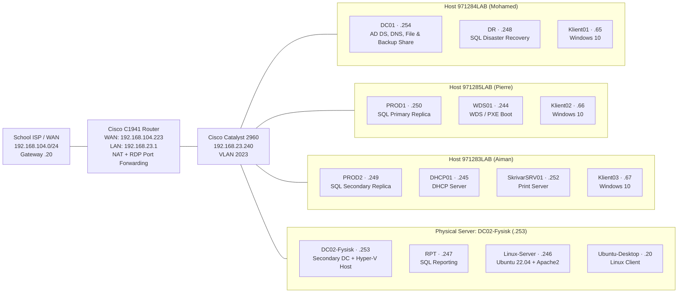

# Branch Office Infrastructure — `fjunne.local` (School Project)

A complete branch-office IT infrastructure built in a group of three (Mohamed, Pierre, and Aiman)
during the university course **Server Systems and Infrastructure** (*Serversystem och
infrastruktur*). Our group was assigned Branch 3 (**Fjunne**, `192.168.23.0/24`), and we built the
network and server environment from scratch across three physical Hyper-V hosts, one physical rack
server, and a physical Cisco router and switch.

This project was where I first worked with Active Directory, DNS, Group Policy, Windows file and
print servers, SQL Server failover clustering, PowerShell automation, WDS network boot, and Linux
integration in a Windows domain. Later, I rebuilt the core Active Directory parts on my own in
[my solo home lab (`lab.internal`)](README.md) to repeat the fundamentals and understand every step
in depth.

**Course:** Server Systems and Infrastructure · **Group 3 (Fjunne):** Mohamed, Pierre, Aiman ·
**Original lab report (Swedish, 59 pages):** [`Serversystem och Infrastruktur.pdf`](Serversystem%20och%20Infrastruktur.pdf) ·
**Tools:** Hyper-V, Windows Server 2019, Windows 10 Education, Ubuntu 22.04/24.04 LTS, Cisco IOS,
ADUC, DNS Manager, GPMC, SQL Server 2014, Failover Cluster Manager, PowerShell, WDS, WinSCP.

---

## Contents

- [What we built](#what-we-built)
- [Topology](#topology)
- [Step by step (L1–L6)](#step-by-step)
  - [1. Network, Cisco router/switch, and NAT (L1 & L2)](#1-network-cisco-routerswitch-and-nat-l1--l2)
  - [2. Primary domain controller (`DC01`) and renaming with `netdom` (L1 & L2)](#2-primary-domain-controller-dc01-and-renaming-with-netdom-l1--l2)
  - [3. Physical secondary domain controller (`DC02-Fysisk`) (L1 & L2)](#3-physical-secondary-domain-controller-dc02-fysisk-l1--l2)
  - [4. Users, groups, Folder Redirection, and Roaming Profiles (L2)](#4-users-groups-folder-redirection-and-roaming-profiles-l2)
  - [5. File server permissions, drive mapping GPO, and print server (L2)](#5-file-server-permissions-drive-mapping-gpo-and-print-server-l2)
  - [6. SQL Server High Availability, storage layout, and Failover Cluster (L3)](#6-sql-server-high-availability-storage-layout-and-failover-cluster-l3)
  - [7. Database administration: DDL, DML, DCL, and backups (L3)](#7-database-administration-ddl-dml-dcl-and-backups-l3)
  - [8. Automated DHCP server with PowerShell (`DHCP01` — L4)](#8-automated-dhcp-server-with-powershell-dhcp01--l4)
  - [9. Network OS deployment with WDS and PXE boot (`WDS01` — L5)](#9-network-os-deployment-with-wds-and-pxe-boot-wds01--l5)
  - [10. Linux web server, UFW firewall, and AD DNS integration (L6)](#10-linux-web-server-ufw-firewall-and-ad-dns-integration-l6)
- [Problems we ran into and how we solved them](#problems-we-ran-into-and-how-we-solved-them)
- [The most important things I learned](#the-most-important-things-i-learned)

---

## What we built

- **Cisco router and switch network (L1 & L2):** Configured a Cisco C1941 router and Catalyst 2960
  switch with VLAN `2023`, outbound NAT/PAT overload toward the lab WAN (`192.168.104.0/24`), and
  static NAT port forwarding so all three of us could connect to our Windows 10 clients via Remote
  Desktop from home over VPN.
- **Two domain controllers (L1 & L2):** Built a primary virtual domain controller (`DC01`) and
  promoted a physical rack server (`DC02-Fysisk`) as a secondary domain controller with DNS and
  Global Catalog.
- **File server, Folder Redirection, and Roaming Profiles (L2):** Created departmental shared
  folders with strict Share and NTFS permissions, redirected users' *Documents* folders to
  `\\DC01\folder_redirection$` via GPO, mapped network drives via GPO Preferences, and used a
  PowerShell script to set roaming profile paths and home drives (`H:`) on all users from a CSV.
- **Print server (L2):** Installed Print and Document Services on `SkrivarSRV01`, added a network
  printer over TCP/IP, shared it as `Kontorsskrivare`, and deployed it with Group Policy.
- **SQL Server High Availability cluster (L3):** Built four database servers (`PROD1`, `PROD2`,
  `RPT`, `DR`), automated 6-disk SCSI storage arrays (`F:`–`K:`) formatted with 64 KB allocation
  units in PowerShell, ran unattended SQL installations with `.ini` files, built a Windows Failover
  Cluster (`FjunneKluster`) with AlwaysOn Availability Groups (`LABSERVER_AG1`), and tested live
  failover and scheduled backups.
- **Automated DHCP server (L4):** Wrote a PowerShell script to install DHCP on `DHCP01`, authorize
  it in Active Directory, create the IPv4 scope and options, and bind MAC reservations for our
  clients.
- **Network OS deployment with WDS (L5):** Configured Windows Deployment Services on `WDS01` with
  `boot.wim` and `install.wim` images and deployed Windows 10 over the network via PXE boot onto a
  new client (`Klient06`).
- **Linux web server and AD DNS integration (L6):** Installed Ubuntu Server 22.04 LTS and Ubuntu
  Desktop on `DC02-Fysisk`, set up Apache2 and the `ufw` firewall, added an `A` record for
  `www.fjunne.local` in AD DNS on `DC01`, and uploaded our group's web page over SCP using WinSCP.

---

## Topology



Traffic between our branch network (`192.168.23.0/24`) and the school's outer lab network
(`192.168.104.0/24`) goes through our Cisco C1941 router (`192.168.23.1` on the inside,
`192.168.104.223` on the outside), which forwards external traffic to the lab ISP gateway
(`192.168.104.20`).

### Network

| | Value |
|---|---|
| Domain | `fjunne.local` (NetBIOS `FJUNNE`) |
| Branch LAN | `192.168.23.0/24` (VLAN `2023`) |
| Default gateway (Cisco 1941) | `192.168.23.1` |
| Cisco 2960 switch IP | `192.168.23.240` |
| Router WAN address (`Gi0/0`) | `192.168.104.223/24` |
| Upstream ISP gateway | `192.168.104.20` |
| Internal DNS servers | `192.168.23.254` (`DC01`), `192.168.23.253` (`DC02-Fysisk`) |
| DHCP scope (`DHCP01`) | `192.168.23.65` – `192.168.23.126` (excluded `.1`–`.10`) |
| Windows Failover Cluster VIP | `192.168.23.50` (`FjunneKluster`) |
| SQL AlwaysOn Listener VIP | `192.168.23.60` (`LABSERVER_AG1`) |

### Physical hardware

| Equipment | Model & Specs | Role |
|---|---|---|
| 1× Router | Cisco C1941 (`C1900-UNIVERSALK9-M`) | WAN/LAN routing, NAT overload, static RDP port forwarding, ACLs |
| 1× Switch | Cisco Catalyst 2960 (`C2960-LANBASEK9-M`) | Layer 2 switching, VLAN 2023, BPDU guard/filter |
| 3× Hyper-V Hosts | HP EliteOne 840 G9 (Core i5-12500, 32 GB RAM, Windows Server 2019 Datacenter) | `971283LAB` (Aiman), `971284LAB` (Mohamed), `971285LAB` (Pierre) |
| 1× Physical Server | HP EliteDesk 800 G1/G2 (Core i5-6500, 16 GB RAM, Windows Server 2019 Datacenter) | `DC02-Fysisk`: Secondary DC + 4th Hyper-V host |

### Servers and clients across the four hosts

| Machine | Host | IP address | RAM / vCPU | OS | Role |
|---|---|---|---|---|---|
| `DC01` | `971284LAB` | `192.168.23.254` | 4 GB / 2 | Windows Server 2019 | Primary DC, DNS, File Server (`F:`), SQL Backup Share |
| `DC02-Fysisk` | Physical rack | `192.168.23.253` | 16 GB / 4 | Windows Server 2019 | Secondary DC, DNS, Global Catalog, Hyper-V Host |
| `DHCP01` | `971283LAB` | `192.168.23.245` | 4 GB / 2 | Windows Server 2019 | PowerShell-automated DHCP server |
| `WDS01` | `971285LAB` | `192.168.23.244` | 2 GB / 2 | Windows Server 2019 | Windows Deployment Services (PXE boot) |
| `SkrivarSRV01` | `971283LAB` | `192.168.23.252` | 4 GB / 2 | Windows Server 2019 | Print Server (`Kontorsskrivare`) |
| `PROD1` | `971285LAB` | `192.168.23.250` | 4 GB / 2 | Windows Server 2019 | SQL Server 2014 primary cluster node (`LABSERVER`) |
| `PROD2` | `971283LAB` | `192.168.23.249` | 4 GB / 2 | Windows Server 2019 | SQL Server 2014 secondary failover node |
| `RPT` | `DC02-Fysisk` | `192.168.23.247` | 2 GB / 2 | Windows Server 2019 | SQL Server reporting node |
| `DR` | `971284LAB` | `192.168.23.248` | 2 GB / 2 | Windows Server 2019 | SQL Server disaster recovery node |
| `Linux-Server` | `DC02-Fysisk` | `192.168.23.246` | 4 GB / 2 | Ubuntu Server 22.04 LTS | Apache2 web server (`www.fjunne.local`) |
| `Ubuntu-Desktop` | `DC02-Fysisk` | `192.168.23.20` | 4 GB / 1 | Ubuntu Desktop LTS | Linux client with remote desktop |
| `Klient01` | `971284LAB` | `192.168.23.65` | 4 GB / 2 | Windows 10 Education | Mohamed's client (MAC `00-15-5D-68-48-00`) |
| `Klient02` | `971285LAB` | `192.168.23.66` | 4 GB / 2 | Windows 10 Education | Pierre's client (MAC `00-15-5D-68-49-00`) |
| `Klient03` | `971283LAB` | `192.168.23.67` | 4 GB / 2 | Windows 10 Education | Aiman's client (MAC `00-15-5D-68-46-00`) |
| `Klient06` | `971285LAB` | DHCP | 2 GB / 2 | Windows 10 Education | Installed over the network via WDS PXE boot |

### Shared folders and permissions (`DC01` — `F:`)

| Share / Folder | Purpose | Share Permissions | NTFS Permissions (inheritance disabled) |
|---|---|---|---|
| `\\DC01\folder_redirection$` | Redirected *Documents* & Home folders (`H:`) | `Authenticated Users` / `Anstallda` | `Administrators` & `SYSTEM`: Full control; `CREATOR OWNER`: Full control (subfolders & files only); `Anstallda`: Special (create folders) |
| `\\DC01\RoamingProfiles$` | Roaming user profiles | `Authenticated Users` | User profile folders created per `SamAccountName` |
| `\\DC01\Backups` | SQL Server backups & `.ini` config | `sqldbe`, `sqlagent`, `Administrators`: Full control (`Everyone` removed) | `sqldbe`, `sqlagent`, `Administrators`: Full control |
| `F:\Ekonomer` | Finance department share | `Ekonomi`: Change & Read; `Administrators`: Full control | `Ekonomi`: Modify/Special (everything except Full control) |
| `F:\Ledning` | Management share | `Ledning`: Change & Read; `Administrators`: Full control | `Ledning`: Full control (also across `Anstallda`, `Publik`, `Saljare`) |
| `F:\Anstallda` | All employees share | `Anstallda`: Change & Read; `Administrators`: Full control | `Anstallda`: Modify/Special (everything except Full control) |
| `F:\Publik` | Public read-only share | `Domain Users`: Change & Read; `Administrators`: Full control | `Domain Users`: Read & Execute |
| `F:\Saljare` | Sales department share | `Forsaljning`: Change & Read; `Administrators`: Full control | `Forsaljning`: Modify/Special (everything except Full control) |

### SQL Server 6-disk SCSI storage layout (`PROD1`, `PROD2`, `RPT`, `DR`)

| Volume | Label | Size | NTFS Allocation Unit | Purpose |
|---|---|---|---|---|
| `F:` | `Program` | 28 GB | Default (4 KB) | SQL Server binaries and shared features |
| `G:` | `SystemDB` | 28 GB | 64 KB (`65536` bytes) | System databases (`master`, `model`, `msdb`) |
| `H:` | `UserData` | 28 GB | 64 KB (`65536` bytes) | User database data files (`.mdf` / `.ndf`) |
| `I:` | `UserLog` | 28 GB | 64 KB (`65536` bytes) | User database transaction logs (`.ldf`) |
| `J:` | `tempdbData` | 28 GB | 64 KB (`65536` bytes) | TempDB data files |
| `K:` | `tempdbLog` | 28 GB | 64 KB (`65536` bytes) | TempDB transaction log |

### Group Policy

| GPO | Configuration Path | Effect |
|---|---|---|
| `folderRedirectionSettings` | *User Configuration > Windows Settings > Folder Redirection > Documents* | Redirects each user's *Documents* folder to `\\DC01\Folder_redirection$\<username>\Documents` |
| `Resurshantering` | *User Configuration > Preferences > Windows Settings > Drive Maps* | Maps departmental shares (`Ekonomer`, `Ledning`, `Anstallda`, `Publik`, `Saljare`) to drive letters starting from `Z:` downwards |
| `Deploy_Printer` | *Computer Configuration > Policies > Windows Settings > Deployed Printers* | Deploys `\\SkrivarSRV01\Kontorsskrivare` to domain computers |

---

## Step by step

### 1. Network, Cisco router/switch, and NAT (L1 & L2)

We connected our three Hyper-V hosts and the physical server to our Cisco 2960 switch and C1941
router. On the router, we configured `GigabitEthernet0/0` (`192.168.104.223/24`) as `ip nat outside`
with a default route to the school's ISP gateway (`192.168.104.20`), and `GigabitEthernet0/1`
(`192.168.23.1/24`) as `ip nat inside`. We enabled NAT overload (PAT) for `192.168.23.0/24` so all
machines could reach external networks through one outside IP:

```ios
interface GigabitEthernet0/0
 ip address 192.168.104.223 255.255.255.0
 ip nat outside
 no shutdown
!
interface GigabitEthernet0/1
 ip address 192.168.23.1 255.255.255.0
 ip nat inside
 no shutdown
!
ip nat inside source list 1 interface GigabitEthernet0/0 overload
ip route 0.0.0.0 0.0.0.0 192.168.104.20
access-list 1 permit 192.168.23.0 0.0.0.255
```

To work from home over VPN, we enabled Remote Desktop on `Klient01–03` and added static NAT port
forwarding rules mapping external TCP ports `4601–4603` on `192.168.104.223` to internal port `3389`
on each client:

```ios
ip nat inside source static tcp 192.168.23.15 3389 192.168.104.223 4603
ip nat inside source static tcp 192.168.23.16 3389 192.168.104.223 4602
ip nat inside source static tcp 192.168.23.17 3389 192.168.104.223 4601
```

On all Windows VMs, we also disabled IPv6 using PowerShell so all traffic stayed on IPv4:

```powershell
Get-NetAdapterBinding | Where-Object ComponentID -eq "ms_tcpip6" | Set-NetAdapterBinding -Enabled $false
```

**What I learned**
- **NAT overload (PAT)** lets an entire internal `/24` subnet share one external IP by tracking
  outbound sessions by port number.
- **Static port forwarding** works in the opposite direction: when someone connects from the outside
  to `192.168.104.223:4603`, the router translates that destination to `Klient01` on port `3389`.
- When we plugged our Cisco switch into the lab's upstream Dell switch, Spanning Tree blocked the
  port because of incoming BPDU frames. Enabling `spanning-tree bpdufilter enable` and
  `spanning-tree bpduguard enable` on the port solved it.
- Disabling IPv6 across the VMs kept DNS lookups and pings strictly on IPv4, which made
  troubleshooting much cleaner.

### 2. Primary domain controller (`DC01`) and renaming with `netdom` (L1 & L2)

I built `DC01` (`192.168.23.254`) on my Hyper-V host, installed **AD DS** and **DNS Server**, and
promoted it to a domain controller. Originally the lab instructions asked every group to join the
teacher's parent domain `it-tek.local` as a child domain, but that did not work in the classroom
environment, so we created our own forest: `fjunne.local`. Then we pointed `Klient01–03` to
`192.168.23.254` for DNS and joined them to the domain.

Because `DC01` still had its auto-generated Windows name (`WIN-GGEFCNFKTFA`) when we promoted it,
we could not simply rename it in `sysdm.cpl` afterwards. Instead, I had to use `netdom` in an
elevated Command Prompt:

```cmd
netdom computername WIN-GGEFCNFKTFA /add:DC01.fjunne.local
netdom computername WIN-GGEFCNFKTFA /makeprimary:DC01.fjunne.local
shutdown /r /t 0
netdom computername DC01.fjunne.local /remove:WIN-GGEFCNFKTFA
```

**What I learned**
- A domain controller's name is registered in Active Directory, DNS SRV records, and Kerberos
  Service Principal Names (SPNs). `netdom` adds the new name first, waits for replication and a
  reboot so everything updates cleanly, and only then removes the old name.
- Having to go through that `netdom` procedure in school is the exact reason I always rename a
  server **before** promoting it to a DC now.

### 3. Physical secondary domain controller (`DC02-Fysisk`) (L1 & L2)

We installed Windows Server 2019 on the physical HP EliteDesk in the rack over the network (F12 PXE
boot), gave it the static address `192.168.23.253/24`, renamed it `DC02-Fysisk`, and joined it to
`fjunne.local`. We wanted it to run both **AD DS** (as a secondary domain controller) and
**Hyper-V** (to host additional VMs).

When we tried installing the Hyper-V role, Server Manager stopped us with:
> *"Hyper-V cannot be installed because virtualization support is not enabled in the BIOS"*

We rebooted the physical machine, pressed F10 to enter BIOS, turned on **Intel Virtualization
Technology (VT-x)** under *Processor Configuration*, and booted back into Windows. After that, both
Hyper-V and AD DS installed cleanly, and we promoted `DC02-Fysisk` to a domain controller in the
existing `fjunne.local` domain with **DNS** and **Global Catalog**.

**What I learned**
- Running two domain controllers (`192.168.23.254` and `192.168.23.253`) gives the domain real
  redundancy. Every server and client in our IP table had `.254` as primary DNS and `.253` as
  secondary DNS, so if one DC went down for a reboot, AD and DNS kept working.
- Hyper-V needs hardware virtualization (`Intel VT-x` or `AMD-V`) enabled in the physical CPU's
  BIOS/UEFI before Windows will let you install the role.

### 4. Users, groups, Folder Redirection, and Roaming Profiles (L2)

In ADUC we created user accounts, template accounts (`Mall_Anstallda`, `Mall_Ekonomi`,
`Mall_Forsaljning`, `Mall_Ledning`), and Global Security Groups (`Anstallda`, `Ekonomi`,
`Forsaljning`, `Ledning`, `ProjektCharlie`, and `Folder redirection users`).

To keep users' files on the server instead of on local client disks, I created a hidden share on
`DC01` at `\\DC01\folder_redirection$`. On the folder permissions, I turned off inheritance and set:
- `Administrators` and `SYSTEM`: *Full control* (This folder, subfolders and files)
- `CREATOR OWNER`: *Full control* (Subfolders and files only)
- `Anstallda`: *Special* permissions to read and create their own subfolder on the root folder

Then I created the GPO `folderRedirectionSettings` (*User Configuration > Windows Settings > Folder
Redirection > Documents*) pointing to `\\DC01\Folder_redirection$`, and unchecked *"Grant the user
exclusive rights to Documents"* under Settings so administrators could still access the folders.

To avoid setting profile paths and home drives by hand on every user, we wrote a PowerShell script
that exported the users to a CSV file and updated all accounts in a loop:

```powershell
Get-ADUser -Filter * -Property * |
    Select-Object Name, SamAccountName, GivenName, SurName, Title, Department |
    Export-Csv -Path "C:\AD_Users.csv" -NoTypeInformation

$users = Import-Csv -Path "C:\AD_Users.csv"
$profilepath = "\\DC01.Fjunne.local\RoamingProfiles$"
$homefolderpath = "\\DC01\Folder_redirection$"

foreach ($user in $users) {
    $profilePathFull = "$profilepath\$($user.samaccountname)"
    $homeDirectoryFull = "$homefolderpath\$($user.samaccountname)"

    Set-ADUser -Identity $user.samaccountname `
        -ProfilePath $profilePathFull `
        -HomeDirectory $homeDirectoryFull `
        -HomeDrive "H:"
}
```

**What I learned**
- Adding `$` at the end of a share name (`folder_redirection$`) hides the share when users browse
  `\\DC01` in File Explorer, while GPOs and UNC paths can still reach it directly.
- Giving `CREATOR OWNER` *Full control* on *Subfolders and files only* is a neat trick: when a user
  logs in for the first time, Windows creates their personal subfolder, and `CREATOR OWNER`
  automatically makes them the owner of their own folder without letting them read anyone else's.
- Unchecking *Grant the user exclusive rights to Documents* avoids locking out Domain Admins when
  backups or troubleshooting are needed.

### 5. File server permissions, drive mapping GPO, and print server (L2)

On the `F:` drive of the file server, we created five shared folders: `Ekonomer`, `Ledning`,
`Anstallda`, `Publik`, and `Saljare`. For each folder we configured both **Sharing** permissions and
**NTFS Security** permissions:
- Disabled NTFS inheritance (*Convert inherited permissions into explicit permissions*) and removed
  the general `Users` group.
- Gave each department group (`Ekonomi`, `Anstallda`, `Forsaljning`) **Special / Modify** rights on
  its own folder (everything except *Full control*).
- Gave `Domain Users` *Read & Execute* on `Publik`.
- Gave `Ledning` (Management) *Full control* across `Ledning`, `Anstallda`, `Publik`, and `Saljare`.

To mount these folders automatically for users, we created the GPO `Resurshantering` (*User
Configuration > Preferences > Windows Settings > Drive Maps*) and mapped the shares to drive
letters starting from `Z:` downwards.

On `SkrivarSRV01` (`192.168.23.252`), we installed **Print and Document Services**, added the lab's
network printer (`192.168.104.250`, HP LaserJet 400 M401 PCL6) as a TCP/IP port in Print Management,
shared it as `Kontorsskrivare`, and deployed it with a GPO named `Deploy_Printer` (*Computer
Configuration > Policies > Windows Settings > Deployed Printers*).

**What I learned**
- When SMB Share permissions and NTFS permissions are combined, **the most restrictive permission
  wins**.
- If you do not disable NTFS inheritance first, the built-in `Users` group inherits read access from
  the root of the drive (`F:\`), which means everyone can read folders meant for Finance or
  Management even if you only added `Ekonomi`!
- Department users get *Modify* (everything except *Full control*) so they can work with files freely
  without being able to change the permissions on the folder itself.

### 6. SQL Server High Availability, storage layout, and Failover Cluster (L3)

For the database module, we built four Windows Server 2019 machines: `PROD1` (primary node),
`PROD2` (secondary failover node), `RPT` (reporting), and `DR` (disaster recovery). We created
`PROD1` in the Hyper-V GUI and automated `PROD2`, `RPT`, and `DR` with a PowerShell `New-VM` script.

Each SQL server needed six separate virtual disks (`F:` through `K:`) on the SCSI controller to
separate SQL binaries, system databases, user data, user logs, and TempDB. We automated creating and
attaching the disks on the Hyper-V host with PowerShell:

```powershell
$DiscName = @('Program', 'SystemDB', 'UserData', 'UserLog', 'tempdbData', 'tempdbLog')
$VM = "PROD1"
$VHDLocation = "D:\VMs\PROD1\"

for ($i = 0; $i -lt $DiscName.Length; $i++) {
    $diskName = $DiscName[$i]
    $vhdPath = "$VHDLocation$diskName.vhdx"
    New-VHD -Path $vhdPath -SizeBytes 28GB -Dynamic
    Add-VMHardDiskDrive -VMName $VM -Path $vhdPath -ControllerType SCSI
}
```

Inside Windows, we formatted `F:` (`Program`) with the default allocation size, and formatted the
five database and log disks (`G:`–`K:`) as NTFS with a **64 KB allocation unit size** (`65536`
bytes).

On `DC01`, we created two dedicated service accounts in AD (`sqldbe` for SQL Server Database Engine
and `sqlagent` for SQL Server Agent) with *Password never expires* and *User cannot change
password*, plus a backup share `\\DC01\Backups` where we removed `Everyone` and granted `sqldbe`,
`sqlagent`, and `Administrators` Full Control.

After installing `.NET Framework 3.5` from `D:\Sources\SXS\`, we installed SQL Server 2014 named
instance `LABSERVER` on `PROD1` via the setup wizard, pointing each data and log path to its own
drive (`G:` through `K:`). On `PROD2`, `RPT`, and `DR`, we ran an **unattended installation** from
the command line using the configuration file saved on the DC share:

```cmd
D:\Setup.exe /ConfigurationFile=\\DC01\Backups\ConfigurationFile.ini
```

We opened TCP ports `5022` (AlwaysOn mirroring endpoint), `15000` (SQL instance port), `16000`, and
`sqlbrowser.exe` in Windows Firewall, disabled the built-in `sa` account in SQL Server Management
Studio (SSMS), installed the **Failover Clustering** feature (`FjunneKluster` at `192.168.23.50`),
and configured **AlwaysOn Availability Groups** (`LABSERVER_AG1` at `192.168.23.60`). When we ran
the Failover Wizard and took `PROD1` down, `PROD2` automatically stepped up as the primary replica
without dropping client connections, and `PROD1` rejoined as secondary once it came back up.

**What I learned**
- **Why 6 separate disks and 64 KB clusters:** SQL Server reads and writes data in 64 KB extents
  (eight 8 KB pages), so formatting `G:`–`K:` with 64 KB NTFS clusters aligns disk I/O with how SQL
  works. Separating data files (random I/O) from transaction logs (sequential writes) and TempDB
  keeps heavy queries from bottlenecking log commits.
- **Unattended `.ini` installs** save a huge amount of time and guarantee that all cluster nodes are
  configured identically (same instance name, same drive paths, same service accounts). Checking
  `"Final result: Passed"` in `Summary.txt` confirms the silent install succeeded.
- **Disabling the `sa` account** and running SQL under dedicated AD service accounts (`sqldbe` and
  `sqlagent`) follows least privilege and forces administrators to authenticate through Active
  Directory rather than a shared SQL password.
- **Failover vs. Disaster Recovery:** In our lab, `DR` sat on the same `192.168.23.0/24` subnet as
  `PROD1` and `PROD2`. While writing our report we realized that in a real company, a `DR` server
  should be placed in a separate physical location and subnet so a power outage or fire doesn't
  take down both production and DR at the same time.

### 7. Database administration: DDL, DML, DCL, and backups (L3)

Inside SSMS, we built the `Northwind` database from scratch using SQL scripts:
- **DDL:** `CREATE DATABASE` with departmental filegroups (`FG_HumanResources`, `FG_Production`),
  `CREATE SCHEMA`, `CREATE TABLE` with primary and foreign keys placed on specific filegroups,
  `BULK INSERT` from text files, `ALTER TABLE` to add `CHECK` (preventing negative `UnitPrice`) and
  `DEFAULT` constraints, and `CREATE VIEW` (`ReorderList` for items where `UnitsInStock <
  ReorderLevel`).
- **DML:** Practiced `SELECT`, `WHERE`, `ORDER BY`, `DISTINCT`, `LIKE`, `INNER/LEFT/RIGHT/FULL JOIN`,
  and `INSERT`/`UPDATE`/`DELETE`.
- **DCL (Security):** Mapped our Active Directory security groups to SQL Server Logins and database
  roles, granted schema-level permissions per department, and logged in as different AD users to
  verify access.
- **Backups:** Configured a SQL Server Agent Maintenance Plan with a **Full backup** every Saturday,
  **Differential backups** Tuesday–Friday, and daily **Transaction Log backups** to
  `\\DC01\Backups`, and practiced restoring the database starting with a tail-log backup.

**What I learned**
- Mapping **AD groups** (instead of individual users) to SQL Server logins and database roles means
  database access is controlled directly from Active Directory: when someone changes department in
  AD, their SQL access updates automatically.
- Combining Full, Differential, and Transaction Log backups keeps daily backups fast while still
  allowing point-in-time recovery. Taking a **tail-log backup** before restoring captures the final
  transactions that happened after the last scheduled log backup.

### 8. Automated DHCP server with PowerShell (`DHCP01` — L4)

In Lab 4, the goal was to build and configure our DHCP server (`DHCP01`, `192.168.23.245`) using
PowerShell instead of the GUI. After provisioning the VM, we wrote a script to install the role,
authorize the server in Active Directory, create the scope, set the gateway and DNS options, and
bind MAC reservations for our three Windows 10 clients:

```powershell
$DHCPServer   = "DHCP01"
$ScopeID      = "192.168.23.0"
$ScopeName    = "Fjunne"
$StartRange   = "192.168.23.65"
$EndRange     = "192.168.23.126"
$SubnetMask   = "255.255.255.0"
$Gateway      = "192.168.23.1"
$DNSServers   = "192.168.23.254", "192.168.23.253"
$DnsName      = "DHCP01.Fjunne.local"
$IPAddress    = "192.168.23.245"

$Reservations = @(
    @{ MAC="00-15-5D-68-48-00"; IP="192.168.23.65"; Name="Klient01" },
    @{ MAC="00-15-5D-68-49-00"; IP="192.168.23.66"; Name="Klient02" },
    @{ MAC="00-15-5D-68-46-00"; IP="192.168.23.67"; Name="Klient03" }
)

if (-not (Get-WindowsFeature -Name DHCP).Installed) {
    Install-WindowsFeature -Name DHCP -IncludeManagementTools
}

Add-DhcpServerInDC -DnsName $DnsName -IPAddress $IPAddress
Add-DhcpServerv4Scope -Name $ScopeName -StartRange $StartRange -EndRange $EndRange `
                      -SubnetMask $SubnetMask -State Active
Set-DhcpServerv4OptionValue -ScopeId $ScopeID -Router $Gateway -DnsServer $DNSServers

foreach ($res in $Reservations) {
    Add-DhcpServerv4Reservation -ScopeId $ScopeID -IPAddress $res.IP `
                                -ClientId $res.MAC -Description $res.Name
}

# Clear the post-install warning flag in Server Manager
Set-ItemProperty -Path registry::HKEY_LOCAL_MACHINE\SOFTWARE\Microsoft\ServerManager\Roles\12 `
                 -Name ConfigurationState -Value 2
Restart-Service DHCPServer
```

**What I learned**
- **AD authorization (`Add-DhcpServerInDC`):** A Windows DHCP server in a domain refuses to hand out
  leases until a Domain Admin authorizes it in Active Directory. That protects the network against
  someone accidentally plugging in a rogue Windows DHCP server.
- **DHCP reservations (`Add-DhcpServerv4Reservation`)** gave us the best of both worlds: our clients
  got their DNS servers and gateway automatically from DHCP, but always kept the exact same IP
  addresses (`.65`, `.66`, `.67`) so our router's RDP port forwarding rules kept working.

### 9. Network OS deployment with WDS and PXE boot (`WDS01` — L5)

We provisioned `WDS01` (`192.168.23.244`) with PowerShell, joined it to `fjunne.local`, and
installed the **Windows Deployment Services** role. In the WDS console, we added a **Boot Image**
(`boot.wim` from the Windows 10 ISO) and created an **Install Image** group containing `install.wim`
for Windows 10 and Windows Server 2019.

To test it, we created a blank VM (`Klient06`) in Hyper-V and selected *Install an operating system
from a network-based installation server*. When `Klient06` started, it booted over PXE, loaded the
WDS installer over the network, installed Windows without any ISO mounted, got an IP from `DHCP01`,
and joined the domain.

**What I learned**
- **How PXE boot works step by step:**
  1. The client boots from its network card (F12) and sends a DHCP broadcast.
  2. `DHCP01` replies with an IP address and tells the client where the WDS/PXE server is.
  3. The client contacts `WDS01` and downloads the boot image (`boot.wim`) over **TFTP** (Trivial
     File Transfer Protocol).
  4. Windows Setup starts in RAM (`WinPE`), and the user selects which `install.wim` OS image to
     install over the network.
- You only need **one** `boot.wim` (preferably from the newest Windows ISO) to boot the installer,
  because `boot.wim` is just the Windows PE setup environment; it can deploy both Windows 10 and
  Windows Server `install.wim` images.
- While WDS handles network booting and image delivery, combining it with **MDT** (Microsoft
  Deployment Toolkit) lets you add drivers, applications (like Office or browsers), and fully
  unattended answer files.

### 10. Linux web server, UFW firewall, and AD DNS integration (L6)

In the final module, we installed **Ubuntu Server 22.04 LTS** (`192.168.23.246`) and **Ubuntu
Desktop** (`192.168.23.20`) as Generation 2 VMs on `DC02-Fysisk`. Before they would boot from the
Ubuntu ISOs, we had to uncheck **Enable Secure Boot** under VM Settings > Security.

On the Ubuntu Server, we installed Apache2 and enabled the Uncomplicated Firewall (`ufw`), making
sure both HTTP/HTTPS and SSH were allowed:

```bash
sudo apt update && sudo apt upgrade -y
sudo apt install apache2 -y
sudo ufw allow 'Apache'
sudo ufw allow OpenSSH
sudo ufw enable
sudo ufw status
```

When we tested from a Windows client browser, `http://192.168.23.246` showed the Apache2 default
page right away, but `http://www.fjunne.local` did not work. To fix that, we updated
`/etc/resolv.conf` on the Linux server (`nameserver 192.168.23.254` and `search fjunne.local`) and
opened **DNS Manager** on `DC01`, expanded *Forward Lookup Zones > Fjunne.local*, and created a
**New Host (A)** record for `www` pointing to `192.168.23.246`.

Finally, we wrote a custom HTML page for Group Fjunne and used **WinSCP** (over SCP/SSH) from a
Windows client to upload `index.html` to `/var/www/html/`, after backing up the default file (`sudo
cp index.html index2.html`) and granting our Linux admin user ownership of the web root (`sudo chown
-R admins:admins /var/www/html`).

**What I learned**
- **Why `192.168.23.246` worked when `www.fjunne.local` failed:** Reaching the server by IP proved
  that networking, Apache, and the `ufw` firewall were all working. The hostname failed purely
  because a standalone Linux machine does not automatically register an `A` record in Windows AD
  DNS—you have to add the host record in DNS Manager.
- On Ubuntu, `ufw` is inactive by default. Before running `sudo ufw enable` over SSH, you always
  make sure `OpenSSH` is allowed so you don't lock yourself out of the server.
- WinSCP uses SSH/SCP under the hood, which means it obeys normal Linux file permissions. Because
  `/var/www/html` is owned by `root` by default, a regular SSH user cannot overwrite `index.html`
  without updating ownership or permissions first.

---

## Problems we ran into and how we solved them

| Problem | Cause | Solution |
|---|---|---|
| Could not promote `DC01` as a child domain under `it-tek.local` | Trust/permissions toward the shared classroom root domain were not available | Adapted the plan and created our own forest, `fjunne.local` |
| Cisco switch port got blocked when connected to the lab's Dell switch | Incoming BPDU frames triggered Spanning Tree port blocking | Enabled `spanning-tree bpdufilter enable` and `bpduguard enable` on the interface |
| `DC01` had the name `WIN-GGEFCNFKTFA` after promotion | Forgot to rename the server before running the AD DS promotion wizard | Renamed the live DC using `netdom computername` (`/add`, `/makeprimary`, reboot, `/remove`) |
| Hyper-V role refused to install on `DC02-Fysisk` | Hardware virtualization was turned off in the physical server's BIOS | Entered BIOS with F10 and enabled *Intel Virtualization Technology (VT-x)* |
| SQL Server backup of `Northwind` failed with *"Culture is not supported"* | The database creation script selected a locale/collation that clashed with the server | Changed the database collation for `Northwind` to `SQL_Swedish` |
| WDS console hung while importing `install.wim` | Large `.wim` file stalled the MMC snap-in on the first attempt | Cancelled, restarted the WDS service/console, and re-imported cleanly |
| Ubuntu VMs would not boot from the ISO | Hyper-V Gen 2 VMs default to Microsoft Windows UEFI Secure Boot | Unchecked *Enable Secure Boot* under VM Settings > Security |
| Ubuntu Server installer rejected the manual IP configuration | Wrote `255.255.255.0` in the `Subnet` field instead of CIDR network notation | Entered the subnet as `192.168.23.0/24` |
| `http://www.fjunne.local` did not load, even though `http://192.168.23.246` worked | No `www` host record existed in AD DNS on `DC01` | Created an `A` record (`www` → `192.168.23.246`) in DNS Manager under `Fjunne.local` |
| WinSCP could not overwrite `/var/www/html/index.html` | `/var/www/html` was owned by `root`, not our SSH user `admins` | Ran `sudo chown -R admins:admins /var/www/html` via PuTTY |
| Confusion early on about who was configuring which server | We started building before reading the entire lab specification from start to finish | Sat down with our planning sheet, mapped out the full IP table across all four hosts, and divided the tasks clearly |

---

## The most important things I learned

- **Read the whole specification and plan the IP table before touching a keyboard.** In school we
  sometimes jumped straight into clicking and had to redo things (like renaming `DC01` with
  `netdom`). That experience is why I built my solo lab methodically, one step at a time.
- **Test by IP first, then by name.** When `www.fjunne.local` failed on our Linux web server,
  testing `192.168.23.246` immediately proved that the network, firewall, and Apache were fine—the
  only missing piece was DNS.
- **Automate repetitive work with PowerShell.** Creating 6 disks per SQL server, setting roaming
  profiles on 15+ users, or configuring DHCP scopes and MAC reservations is much faster and less
  error-prone in a script than in the GUI.
- **Redundancy works at every layer.** Having two domain controllers (`DC01` and `DC02-Fysisk`) kept
  AD and DNS alive during reboots, and SQL AlwaysOn Availability Groups kept the database online
  when `PROD1` failed over to `PROD2`.
